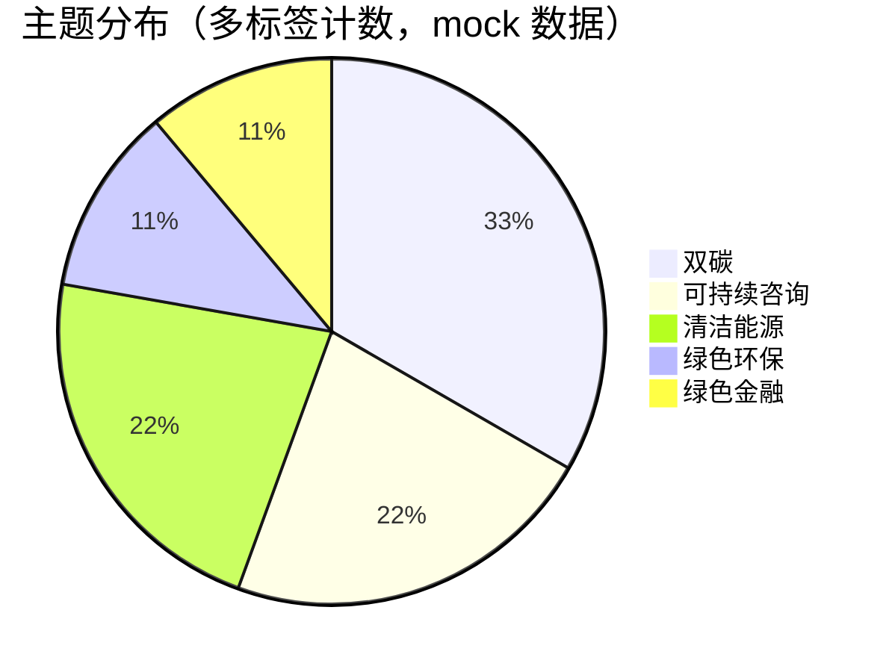

# ESG/双碳领域招投标市场回顾报告（DEMO）

> 样本说明：入库 8 条 | 来源构成：一级 3 / 二级 3 / 三级 2 | 金额可解析率 87.5%
> 统计口径：公开可检索样本，非全量市场数据 | 编制：esg-bid-monitor Skill 测试 demo

## 摘要
（demo）基于 8 条 mock 样本：最热主题为「双碳」（3 条）；金额重心位于 100-500万 区间；中标金额中位数 450.0 万元、均值 2465.5 万元；金额缺失率 12.5%。

## 核心发现速览
| # | 发现 | 关键数字 |
|---|---|---|
| 1 | 最热主题 | 双碳 3 条 |
| 2 | 金额可解析率 | 87.5% |
| 3 | 中标金额中位数 | 450.0 万元 |

## 一、市场总览
- 总样本 8 条，覆盖 5 个月：2024-11、2025-03、2026-09、2026-10、2026-11

## 二、热点主题分析

- 解读（demo 占位）：真实运行时此处由检索证据支撑主题热度成因分析。

## 三、中标金额分布
- 有金额样本 7 条 / 缺失 1 条（缺失率 12.5%）
- 总额 17258.5 万元 | 均值 2465.5 万元 | 中位数 450.0 万元
- 分桶：50-100万 1 条、100-500万 3 条、500-1000万 1 条、1000-5000万 1 条、≥1亿 1 条

## 四、地域与采购人分析
- 省份 Top：测试省某市(2)、广东(测试)(1)、北京(测试)(1)、江苏(测试)(1)、上海(测试)(1)
- 采购人类型分布见 demo_stats.json 的 buyer_type 字段（demo 略图）

## 五、中标格局
| 企业 | 中标次数 | 累计金额(万元) |
|---|---|---|
| 测试环科院A | 2 | 428.5 |
| 测试运维B | 1 | 12000.0 |
| 测试咨询C | 1 | 80.0 |
| 测试建设D | 1 | 3500.0 |
| 测试证券E | 1 | 0.0 |

## 六、趋势研判与投标建议
1. （demo 占位）真实运行时此处给 ≥3 条可操作建议：主攻主题、价位带、平台与客户类型。

## 附录
A. 明细数据：tests/demo_output/mock_bids.jsonl（全部为 TEST- mock 数据）
D. 局限性声明：本报告为 demo 产物，数据为人工构造，不代表真实市场。