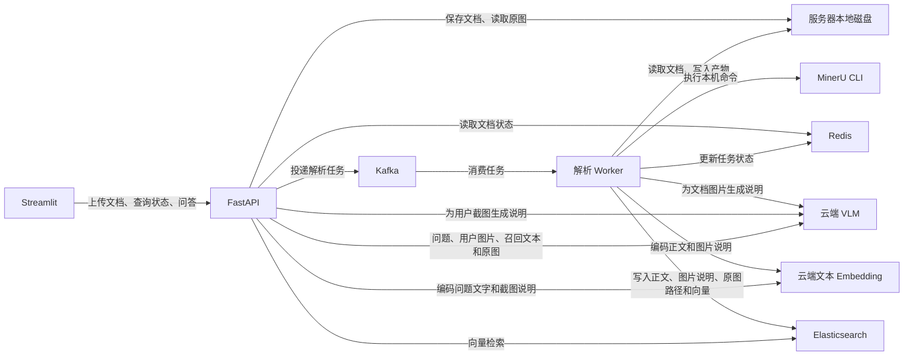

# VLM RAG · 多模态知识库

面向单用户的文档知识库与单轮问答应用。每次上传一个 PDF 或 Word 文件（`.pdf`、`.doc`、`.docx`），知识库可累积多个文档。用户可以输入文字、上传多张图片，或同时提交图文。系统从所有已就绪的文档检索证据，答案可在相关段落插入 文档原图，页面无需展示来源标注。

**项目阶段**：首版代码已实现，待使用服务器上的实际中间件、MinerU CLI 和云端模型完成联调。

左侧菜单提供「文件管理」和「多模态 RAG 问答」。文件管理显示上传入口、文档状态、重试和删除操作。问答窗口上方显示当前会话的记录，点击右上角「新会话」可清空记录和当前输入。下方可以输入文字、选择图片，或用 Ctrl+V / ⌘V 粘贴图片。图片粘贴需要 Streamlit 1.59 或以上。每次检索只使用本次输入。

## 系统架构



Streamlit、FastAPI、Worker 和 MinerU CLI 在同一台应用服务器上运行。FastAPI 和 Worker 共用数据目录。Kafka、Redis 和 Elasticsearch 使用已有服务的连接地址。Redis 已开启持久化。

## 文档入库

1. Streamlit 通过 HTTP 向 FastAPI 上传一个文档。FastAPI 分配文档 ID，把原始文件写入本地目录，在 Redis 登记为「待解析」，并向 Kafka 投递任务。Kafka 消息仅包含任务信息，例如 `document_id`、相对于数据目录的 `file_path` 和 `attempt_id`。
2. Worker 消费任务，标记「解析中」，调用服务器上的 MinerU CLI。Worker 读取本机文档，将结构化解析结果和提取的原图保存到该文档的目录。
3. Worker 切分正文，并调用 VLM 为每张提取的图片生成说明。正文片段和图片说明都由同一个文本 Embedding 模型编码。保留图片和图注或邻近正文的关联。
4. Worker 将正文、图片说明、原图相对路径、关联 ID 和向量写入 Elasticsearch。等本次写入全部成功、向量可被检索、原图可读取后，再将文档标为「解析完成」。

Elasticsearch 中每条记录代表一个正文片段或一张图片。`text` 保存正文或 VLM 生成的图片说明，图片记录还保存原图相对路径。向量字段使用 `dense_vector`，入库和查询使用同一文本模型及维度。[Elasticsearch 向量检索文档](https://www.elastic.co/docs/solutions/search/vector/knn)

## 状态、重试和删除

Streamlit 自动轮询文档列表。Kafka 投递成功后，上传请求返回文档 ID，用户可在列表查看进度。

| 状态 | 含义 | 页面操作 |
| --- | --- | --- |
| 待解析 | 文档已保存，等待 Worker 开始处理 | 查看状态 |
| 解析中 | 正在执行 MinerU、提取内容、生成向量或写入索引 | 查看状态 |
| 解析完成 | 索引已可检索，原图可读取 | 删除 |
| 解析失败 | 任务投递或处理失败 | 查看原因、重试、删除 |
| 清理中 | 文档已退出检索，正在清理索引和本地文件 | 清理失败时可再次删除 |

- **失败与重试**。Redis 保存失败阶段、可读原因和重试记录。手动重试复用原始文件 和文档 ID，创建新的尝试 ID，清理上一次留下的产物和索引，再从 MinerU 解析开始。重复消息按文档 ID 和尝试 ID 识别。Worker 重启后应能恢复未完成的任务，或将其标为失败并开放重试。
- **删除**。只接受已完成或失败的文档。先从就绪集合移除该文档，随后清理 Elasticsearch 索引条目和本地原始文件、解析结果及原图。清理成功后移除文档记录。清理失败时保留可重试的清理记录，文档仍然退出检索。
- **检索可见性**。问答以 Redis 中的就绪文档 ID 过滤 Elasticsearch 查询。待解析、处理中、失败及已退出就绪集合的文档均不可召回。读取原图时也检查文档是否就绪。

## 多模态问答

1. 支持纯文字、文字加一张或多张图片、纯一张或多张图片。用户至少提交一种输入。
2. 非空问题文字直接生成文本向量。每张截图先由 VLM 生成说明，再为说明生成文本向量。问题文字检索正文和图片说明，截图说明优先检索图片说明，未命中时再查正文。只检索就绪文档。
3. 保留每路的最佳匹配，再按融合排名补齐结果，按条目 ID 去重。查询索引里的图文关联，并在同一页补查相邻条目。
4. 将问题、用户图片、召回的图片说明、关联正文和文档原图一起提交给云端 VLM。证据不足时，提示知识库没有找到足够资料。
5. Streamlit 按答案顺序渲染文字和原图。VLM 漏掉主要匹配的原图时，FastAPI 在指向该图的段落后补图，或将原图和关联段落一起展示。没有可用原图时展示纯文字。

从旧版迁移时，在 `config.yaml` 将 `elasticsearch.index` 改为新名称，例如 `vlm-rag-text-v2`。核对 `elasticsearch.dimensions` 与文本模型的输出维度，更新并重启 API 和 Worker，然后重新上传需要检索的文档。旧文档可能仍在 Redis 列表中显示「解析完成」，重新入库后才会进入新索引。`index_ready` 的 `image_entries` 记录每份文档的图片说明条目数。

首版限制单个文档最大 50 MiB。每次提问最多输入 4000 个字符、上传 4 张 PNG 或 JPEG 图片，单图最大 5 MB。

### 云端模型接入

FastAPI 和 Worker 使用 **OpenAI Python SDK** 连接云端服务。Embedding 与 VLM 分别配置服务地址、模型和凭据。

| 服务 | 接入要求 |
| --- | --- |
| 文本 Embedding | `/embeddings` 接收文本字符串。示例使用 SiliconFlow 的 `Qwen/Qwen3-Embedding-8B`，维度为 4096。[SiliconFlow Embedding 文档](https://docs.siliconflow.cn/docs/api/embeddings-post) |
| VLM | Chat Completions 接口用于生成图片说明及最终答案。示例使用 `Qwen/Qwen3-VL-32B-Instruct`，模型须能在同一问答请求中读取多张图片和正文。 |

Embedding 和 VLM 的 `base_url` 都填到 `https://api.siliconflow.cn/v1`。后端按 `elasticsearch.dimensions` 校验向量长度。联调时分别验证图片说明生成和文本向量生成。[OpenAI Embeddings 请求格式](https://developers.openai.com/api/reference/resources/embeddings/methods/create) · [OpenAI 视觉输入文档](https://developers.openai.com/api/docs/guides/images-vision)

## 项目结构

以下为主要项目文件。`frontend/` 存放 Streamlit 界面，`backend/` 存放 FastAPI、解析 Worker 和服务端共享模块。

```text
vlm-rag/
├── README.md
├── requirements.txt            # Python 依赖
├── config.example.yaml        # 应用配置示例，部署时复制为 config.yaml
├── frontend/
│   └── streamlit_app.py       # 文档列表、上传、重试、删除和问答页面
└── backend/
    ├── __init__.py
    ├── main.py                # FastAPI 进程启动入口
    ├── api/
    │   ├── main.py            # 创建 FastAPI 应用并注册路由
    │   ├── documents.py       # 文档上传、列表、重试、删除及原图读取
    │   └── qa.py              # 接收图文问题，返回有序答案块
    ├── service/
    │   ├── documents.py       # 本地文件、Redis 状态、Kafka 投递、重试和删除
    │   ├── ingest.py          # 执行 MinerU、切分内容、生成向量并写入 ES
    │   ├── index.py           # Elasticsearch 索引映射、读写和向量搜索
    │   ├── retrieval.py       # 多路向量检索、合并排名并补齐图文证据
    │   ├── qa.py              # 组织问题和证据、生成答案并校验图片引用
    │   └── model_clients.py   # 通过 OpenAI SDK 调用云端 Embedding 和 VLM
    ├── models/
    │   ├── document.py        # 文档状态、文档信息和 Kafka 任务的数据结构
    │   ├── index_entry.py     # 正文片段、图片位置及关联信息的索引结构
    │   └── qa.py              # 问答输入和文本、图片答案块的数据结构
    ├── worker.py              # 消费 Kafka 任务并调用入库服务
    ├── logging_setup.py       # API 和 Worker 共用的日志配置
    └── config.py              # 加载服务地址、模型和服务器数据目录配置
```

| 目录 | 职责 |
| --- | --- |
| `api/` | HTTP 接口层，接收和校验请求，调用服务层并返回响应。 |
| `service/` | 业务逻辑与外部服务调用，负责入库、状态管理、检索和问答。FastAPI 和 Worker 共用这里的业务逻辑及 Embedding 客户端。 |
| `models/` | 定义各层共用的数据结构，包括文档状态、Kafka 任务、索引条目和问答数据。云端模型的调用代码放在 `service/model_clients.py`。 |

Streamlit 通过 HTTP 调用 `api/`。FastAPI 和 Worker 都调用 `service/`，接口层和服务层都可以使用 `models/` 中的数据结构。

服务器数据目录由 `config.yaml` 指定，供 FastAPI 和 Worker 共用。每个文档以文档 ID 创建目录，存放原始文件、MinerU 的结构化结果和提取的原图。

```text
<数据目录>/
└── documents/
    └── <document_id>/
        ├── source.pdf / source.doc / source.docx
        └── parsed/
            ├── 结构化解析结果
            └── images/
```

## HTTP 接口

| 方法和路径 | 用途 |
| --- | --- |
| `POST /documents` | 以 multipart 表单字段 `file` 上传一个 PDF 或 Word 文件，返回文档 ID 和初始状态 |
| `GET /documents` | 返回文档列表、状态、失败原因及可用操作 |
| `POST /documents/{document_id}/retry` | 重新投递失败文档 |
| `DELETE /documents/{document_id}` | 删除已完成或失败的文档及关联数据 |
| `POST /ask` | 接收表单字段 `text` 和可重复的 `images`，返回有序答案块 |
| `GET /documents/{document_id}/images/{image_id}` | 按图片 ID 读取就绪文档的原图 |

## 服务器部署与联调

服务器使用 Python 3.12.11。只维护一份应用配置。上传程序后，在服务器修改配置并启动 FastAPI、Worker 和 Streamlit。端到端联调在服务器完成。

| 配置项 | 部署时填写 |
| --- | --- |
| 数据目录 | FastAPI 与 Worker 共用、具备读写权限的持久目录 |
| MinerU | CLI 可执行文件、适配已安装版本的参数和运行超时。产物需要包含结构化内容及原图。[MinerU CLI 文档](https://opendatalab.github.io/MinerU/usage/cli_tools/) |
| Kafka（`kafka_2.13-4.4.0`） | Broker 地址、解析任务主题、消费组及所需认证 |
| Redis（`7.2.5`） | 连接地址及所需认证 |
| Elasticsearch（`8.15.3`） | 连接地址、索引名、向量维度及所需认证 |
| Embedding 与 VLM | 各自的云端地址、模型和凭据 |
| Streamlit | FastAPI 服务地址 |

默认使用 MinerU 4.x 的 `mineru-kit parse` 生成 ZIP，读取其中的 `structured_content.json` 和原图。服务器上的 MinerU CLI 必须支持要上传的文件格式。可分别用一个包含正文和插图的 PDF 和 Word 文件验证命令和产物。旧版 CLI 如仅支持 PDF，需升级到支持 Word 的版本。[MinerU 文件格式](https://opendatalab.github.io/MinerU/next/cli/mineru-kit-parse/)确认 Worker 能消费任务，FastAPI 能查询 Redis 和 Elasticsearch，并用实际模型验证图片向量、文本向量和多图问答输入。

### 准备 Kafka Topic

启动 Worker 前，在 `config.yaml` 指向的 Kafka 集群上确认 `kafka.topic` 已存在。应用启动时会订阅 Topic。若日志出现 `kafka_poll_error code=3`，先核对 Topic 名称和 Broker 地址，再检查 Topic 的分区状态。[Kafka 运维文档](https://kafka.apache.org/44/operations/basic-kafka-operations/)

在 Kafka 安装目录执行以下命令。将示例 Broker 地址和 Topic 名称换成配置文件里的值。

```bash
bin/kafka-topics.sh --bootstrap-server 127.0.0.1:9092 --describe --topic vlm-rag-ingest
```

如果提示 Topic 不存在，单 Broker 部署可这样创建。多 Broker 集群按实际部署要求设置副本数。启用 SASL 或 TLS 时，为命令追加 `--command-config /path/to/client.properties`。

```bash
bin/kafka-topics.sh --bootstrap-server 127.0.0.1:9092 \
  --create --if-not-exists --topic vlm-rag-ingest --partitions 1 --replication-factor 1
```

创建后再次执行 `--describe` 确认分区已有 Leader。之前投递失败的文件 可以在页面点击「重试」。

### 启动方法

从项目根目录使用服务器默认的 `python3` 安装依赖，再根据服务器实际地址和凭据填写 `config.yaml`。依赖安装到运行服务的账号下。

```bash
python3 --version  # 预期输出 Python 3.12.11
python3 -m pip install --user -r requirements.txt
cp -n config.example.yaml config.yaml
```

三个进程分别在独立终端启动，使用同一个账号和 `python3`，并以项目根目录作为工作目录。同一数据目录运行一个 Worker。Kafka 消费位点在任务状态写入 Redis 后提交，Worker 重启时可继续处理未提交的消息。

1. **FastAPI**。`backend/main.py` 启动 Uvicorn，由它加载 `backend/api/main.py` 提供的 `app`。

   ```bash
   python3 -m backend.main
   ```

   启动后可在服务器执行 `curl -f http://127.0.0.1:8000/documents`，检查文档列表接口是否可用。

2. **解析 Worker**。直接运行 `backend/worker.py` 模块，由其 `main()` 启动 Kafka 消费循环。

   ```bash
   python3 -m backend.worker
   ```

3. **Streamlit**。在 `config.yaml` 中将前端的 FastAPI 地址设为 `http://127.0.0.1:8000`，再启动页面。

   ```bash
   python3 -m streamlit run frontend/streamlit_app.py --server.address 0.0.0.0 --server.port 8501
   ```

   启动后在浏览器访问服务器的 `8501` 端口。

### 后端日志

API 启动入口统一输出时间、级别、模块名和消息。默认级别为 `INFO`，启动日志记录监听地址，Uvicorn 继续输出服务和请求访问日志。

Worker 和业务模块沿用同一日志格式，并在关键节点记录以下信息。

| 环节 | 记录内容 |
| --- | --- |
| 文档管理 | 任务投递、重试和删除结果，带上文档 ID 和尝试 ID。 |
| Worker 入库 | 开始处理、MinerU 启动与完成、索引就绪及各阶段耗时。MinerU 的 stdout 和 stderr 会直接写到 Worker 输出。 |
| 问答 | 请求耗时、输入图片数量、召回数量和生成结果状态。 |

日志字段使用任务 ID、状态、计数和耗时。应用日志记录任务和错误元数据。MinerU CLI 的原始输出另随 Worker 输出转发，分享前请去掉敏感内容。

服务器联调时，可在项目根目录开两个终端，用以下命令分别启动 API 和 Worker，同时保存日志。

```bash
# 终端 1
python3 -m backend.main 2>&1 | tee -a /tmp/vlm-rag-api.log

# 终端 2
python3 -m backend.worker 2>&1 | tee -a /tmp/vlm-rag-worker.log
```

复现问题后，发来页面报错、操作步骤和对应日志上下文。上传、重试和删除先查 API 日志，解析失败再按 `document_id` 或 `attempt_id` 查 Worker 日志。问答报错主要看 API 日志。

```bash
grep -n -C 5 -E 'dispatch_failed|delete_failed|request_failed|answer_failed' /tmp/vlm-rag-api.log
grep -n -C 5 -E 'ingest_failed|worker_failed|kafka_poll_error' /tmp/vlm-rag-worker.log
```

Worker 的 `stage` 标记失败环节。`prepare` 对应原始文件，`mineru` 对应解析命令，`extract` 对应解析产物，`describe` 对应 VLM 生成图片说明，`embedding` 对应文本向量生成，`index` 对应 ES 映射和写入。日志有时还会包含 HTTP 状态码、云端请求 ID、命令退出码和代码位置。MinerU 命令失败时，可在服务器单独运行 `mineru.command`，替换 `{input}` 和 `{output}`，查看 CLI 原始错误。分享日志前请去掉密钥及敏感内容。

## 首版验收

- 分别上传 PDF 和 Word，每次只上传一个。两份文档独立入库，均可参与默认检索。
- 页面自动更新状态。MinerU 已结束但向量尚不可检索时，页面继续显示「解析中」。
- 使一次解析或索引写入失败，确认列表显示失败原因且问答检索不到该文档。修复后点击重试，确认沿用文档 ID，索引中无重复条目。
- 分别提交纯文字、文字加多张图、纯多张图。确认每份输入分别参与向量检索，VLM 收到原始用户图片与相关文档证据。
- 用包含图表的文档验证跨模态检索。纯文字可以召回相关图片，纯图片可以召回相关正文。
- 相关 文档原图可插在对应答案段落，页面无需显示出处。证据不足时返回明确提示。
- 删除已就绪文档后，新问答不再召回该文档，关联索引和本地文件得到清理。重启应用后，仍可看到 Redis 中保留的文档及任务状态。
