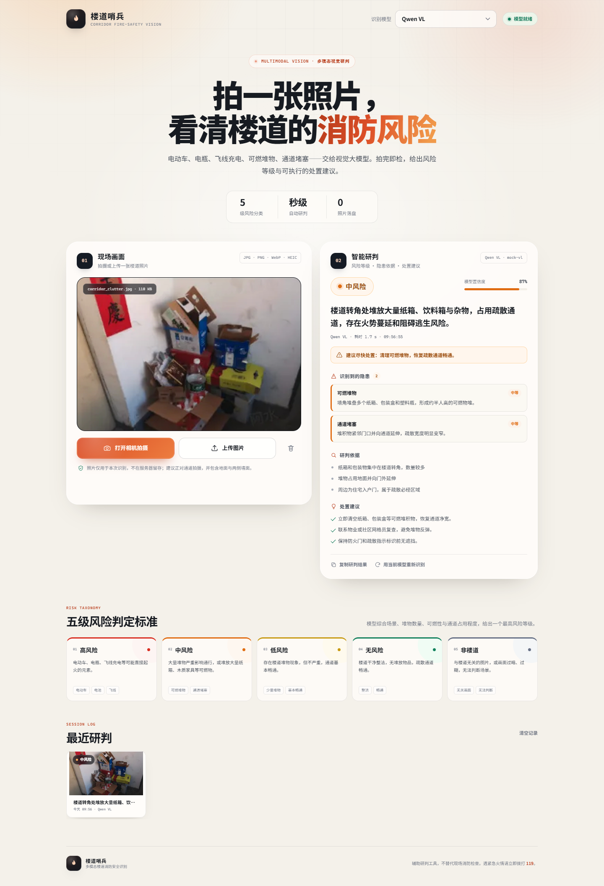
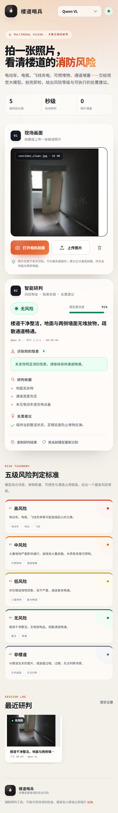

# 楼道哨兵 · 楼道消防安全隐患识别

Week12 作业一：带前后端的楼道消防安全多模态识别应用。用手机网页拍照或上传图片，调用 **Qwen-VL / DeepSeek Flash 4.1** 视觉大模型，实时判断画面是否为楼道、是否存在消防隐患，并输出 **无风险 / 低风险 / 中风险 / 高风险 / 非楼道** 五级研判。

| 桌面端 | 手机端 |
| --- | --- |
|  |  |

> 截图使用本地 mock 模型与 `samples/` 示例图片生成，仅展示界面与交互；真实识别效果取决于所配置的视觉模型。

## 功能

- **两种取图方式**
  - 网页内实时取景：`getUserMedia` 调用手机后置/前置摄像头，网页内取景、拍照。
  - 系统相机 / 相册：手机端原生相机拍摄，或上传已有照片；桌面端支持拖拽上传。
- **五级风险研判**：不仅给等级，还输出隐患类别、严重程度、画面依据和可执行处置建议。
- **双模型可切换**：Qwen-VL 与 DeepSeek Flash 4.1，均通过 OpenAI 兼容接口调用；只配置一个 Key 也能运行。
- **结构化输出**：强制模型返回 JSON，后端再做归一化、风险等级校验和异常兜底。
- **移动端适配**：390px 宽度无横向滚动；相机取景全屏，拍照后自动识别。
- **隐私优先**：照片只在内存中处理，不落盘；重新编码时移除 EXIF/GPS；API Key 仅保存在服务端 `.env`。
- **本次会话历史**：最近 6 次研判可在页面内回看（刷新后清空）。

## 技术架构

```text
┌──────────────────────────── Browser ────────────────────────────┐
│  HTML + CSS + 原生 JS                                           │
│  getUserMedia 取景 / <input capture> 系统相机 / 上传 / 拖拽      │
└───────────────────────────────┬─────────────────────────────────┘
                                │ multipart/form-data（图片 + provider）
┌───────────────────────────────▼─────────────────────────────────┐
│  FastAPI                                                        │
│  /api/analyze  → 大小与 MIME 校验 → Pillow 校验/缩放/去 EXIF     │
│                → OpenAI 兼容视觉模型 → JSON 解析 → 结果归一化    │
│  /api/providers · /api/health · /docs                            │
└───────────────────────────────┬─────────────────────────────────┘
                                │ data:image/jpeg;base64,...
┌───────────────────────────────▼─────────────────────────────────┐
│  Qwen-VL（DashScope）  或  DeepSeek Flash 4.1（OpenAI 兼容）    │
└─────────────────────────────────────────────────────────────────┘
```

参考案例中的 Qwen2.5-VL 本地推理需要约 24GB GPU、单张图约 1 秒/更长的加载时间；本作业把同一条 Qwen-VL 路线做成 API 服务，前后端分离、手机可用，也便于切换 DeepSeek。

## 快速开始

要求：Python 3.10+（在 Python 3.12 / Windows 11 上测试）。

```bash
# 1. 安装依赖
pip install -r requirements.txt

# 2. 复制配置并填写至少一个模型 Key
# Windows CMD: copy .env.example .env
# PowerShell / Git Bash: cp .env.example .env

# 3. 启动
python run.py
```

打开 <http://127.0.0.1:8000>。启动日志会打印局域网地址，例如：

```text
Local:  http://127.0.0.1:8000
Phone:  http://192.168.1.23:8000  (same Wi-Fi)
Models: Qwen VL
```

### 手机访问

1. 手机与电脑连接同一 Wi-Fi；
2. 浏览器打开启动日志中的 `Phone` 地址；
3. 若 Windows 防火墙弹窗，请允许“专用网络”。

> 手机通过普通 HTTP 访问时，Chrome/Safari 会禁止网页内 `getUserMedia`。此时“打开相机拍摄”会自动回退到**系统相机**（原生拍照），上传图片也不受影响。要用手机网页内的实时取景，需要通过 HTTPS 反向代理/tunnel 暴露服务。

## 模型配置

复制 `.env.example` 为 `.env`，填写 Qwen 或 DeepSeek 的配置。两套配置至少填一个。

| 变量 | 说明 | 默认值 |
| --- | --- | --- |
| `DEFAULT_PROVIDER` | 默认模型：`qwen` / `deepseek` | `qwen` |
| `QWEN_API_KEY` | 阿里云百炼 DashScope API Key | 空 |
| `QWEN_BASE_URL` | DashScope OpenAI 兼容地址 | `https://dashscope.aliyuncs.com/compatible-mode/v1` |
| `QWEN_MODEL` | 视觉模型 ID | `qwen-vl-max-latest` |
| `DEEPSEEK_API_KEY` | DeepSeek API Key | 空 |
| `DEEPSEEK_BASE_URL` | DeepSeek 兼容地址 | `https://api.deepseek.com` |
| `DEEPSEEK_MODEL` | 视觉模型 ID | `deepseek-v4.1-flash` |
| `HOST` / `PORT` | 监听地址 / 端口 | `0.0.0.0` / `8000` |
| `MAX_UPLOAD_MB` | 上传大小上限 | `12` |
| `MAX_IMAGE_SIDE` | 送入模型前最长边（像素） | `1600` |
| `REQUEST_TIMEOUT` | 模型请求超时（秒） | `90` |
| `OPEN_BROWSER` | 启动后自动打开浏览器 | `1` |

说明：

- **Qwen**：默认 `qwen-vl-max-latest`，也可改为 `qwen-vl-plus`、`qwen3-vl-plus` 等。若使用 Qwen3-VL，后端会自动传入 `enable_thinking=false` 以控制延迟。
- **DeepSeek**：模型 ID 以你的服务商实际提供的视觉模型为准。请确认该接口支持 `image_url` 图片输入；如果返回 400 或提示模型不支持图片，请切换到 Qwen。
- 某个模型未填 Key 时，前端会显示“未配置”并禁用该选项；已配置的模型仍可正常使用。
- 修改 `.env` 后需要重启 `python run.py`。

## 风险判定标准

| 等级 | 判定要点 | 典型画面 |
| --- | --- | --- |
| **高风险** | 出现电动车、电瓶/电池、飞线/私拉电线充电、明火等可能直接起火的元素；任一出现即最高优先级 | 电动车停在楼道、窗口垂线充电、电池入户 |
| **中风险** | 大量堆积物严重影响通行，或大量纸箱、木质家具、泡沫等可燃物可能造成火势蔓延 | 纸箱杂物堆到半人高、通道需侧身通过 |
| **低风险** | 存在堆物但不严重，通道基本畅通，可燃物较少 | 靠墙鞋架、少量纸袋/绿植 |
| **无风险** | 楼道干净整洁，无堆放物品，疏散通道畅通 | 空置走廊、楼梯间 |
| **非楼道** | 与楼道无关，或过暗、过糊、构图不完整无法判断 | 室内房间、街景、自拍、截图、宠物特写 |

实现上，模型先判断场景是否为楼道；非楼道直接返回“非楼道”，不臆测隐患。多类隐患并存时取最高等级。

## API

### `POST /api/analyze`

`multipart/form-data`：

| 字段 | 类型 | 说明 |
| --- | --- | --- |
| `file` | 文件 | JPG / PNG / WebP / HEIC 图片 |
| `provider` | 字符串，可选 | `qwen` 或 `deepseek`，默认取 `DEFAULT_PROVIDER` |

```bash
curl -X POST http://127.0.0.1:8000/api/analyze \
  -F "file=@samples/corridor_clutter.jpg" \
  -F "provider=qwen"
```

响应示例（节选）：

```json
{
  "analysis_id": "c3b0c7d5a1f2",
  "is_corridor": true,
  "risk_level": "中风险",
  "confidence": 0.87,
  "summary": "楼道转角处堆放大量纸箱、饮料箱与杂物，占用疏散通道。",
  "hazards": [
    {
      "category": "可燃堆物",
      "description": "墙角堆叠多个纸箱、包装盒和塑料瓶。",
      "severity": "medium"
    }
  ],
  "evidence": ["纸箱和包装物集中在楼道转角", "堆物占用地面并向门外延伸"],
  "suggestions": ["立即清空纸箱等可燃堆积物，恢复通道净宽。"],
  "need_action": true,
  "provider": "qwen",
  "provider_label": "Qwen VL",
  "model": "qwen-vl-max-latest",
  "elapsed_ms": 3820,
  "timestamp": "2026-10-27T10:00:00+08:00"
}
```

### 其他接口

- `GET /api/providers`：可用模型、是否已配置、默认模型（不返回 Key）。
- `GET /api/health`：健康检查与已配置模型。
- `GET /docs`：FastAPI 自动生成的接口文档。Swagger UI 的前端资源来自 jsDelivr CDN；若当前网络无法访问 CDN，页面会加载失败，但接口本身不受影响，可继续使用 `curl` 或前端页面。

## 关键实现

- **提示词约束**：系统提示要求只输出 JSON；明确五级定义和优先级；声明图片中的文字只是场景内容，不能作为指令（防提示词注入）。
- **JSON 兜底**：兼容 ```json 代码块、前后夹杂说明、尾逗号；解析失败返回可读错误而不崩溃。
- **结果归一化**：统一风险别名、百分比置信度、字符串/对象形式的隐患、缺失建议；`is_corridor=false` 强制覆盖为“非楼道”。
- **图片预处理**：Pillow 校验真实图片、EXIF 自动旋转、透明底铺白、最长边缩放到 1600、重编码 JPEG（移除 GPS 等元数据），避免超大图片消耗视觉 token。
- **失败降级**：`response_format` 被服务端拒绝时自动退回纯提示词 JSON；鉴权、限流、超时、连接失败分别映射为中文提示。
- **安全**：内容长度上限、MIME 与真实图片双重校验、CSP、`Permissions-Policy: camera=(self)`、接口 `no-store`。

## 测试

```bash
pip install -r requirements-dev.txt
python -m pytest -q
# 17 passed
```

覆盖：JSON 提取/修复、风险归一化、非楼道覆盖、置信度百分比、字符串隐患、图片缩放与格式校验、API 参数校验、损坏图片、未知模型。

无 API Key 时，可用内置 mock 服务体验完整前后端：

```bash
# 终端 1：启动模拟视觉模型（返回固定/轮换的示例研判）
python tests/mock_llm_server.py

# 终端 2：让应用指向 mock
# Git Bash:
QWEN_API_KEY=mock \
QWEN_BASE_URL=http://127.0.0.1:9011/v1 \
QWEN_MODEL=mock-vl \
python run.py

# Windows CMD:
# set QWEN_API_KEY=mock
# set QWEN_BASE_URL=http://127.0.0.1:9011/v1
# set QWEN_MODEL=mock-vl
# python run.py
```

mock 默认按“中 → 高 → 低 → 无 → 非楼道”轮换，便于检查五种结果样式；仅用于 UI 测试，不代表真实模型效果。已用 Playwright 在 1440px 桌面和 390px 手机视口完成端到端验证（含网页内相机取景、上传、结果渲染、历史记录，无控制台报错）。

示例图片 `samples/corridor_clean.jpg` 与 `samples/corridor_clutter.jpg` 裁自课程参考 notebook，仅用于本地演示与测试。

## 目录结构

```text
.
├── app/
│   ├── config.py          # 环境变量 / 模型 Provider
│   ├── imaging.py         # 图片校验、缩放、去 EXIF
│   ├── vision.py          # 提示词、模型调用、JSON 归一化
│   ├── main.py            # FastAPI 路由与静态资源
│   └── static/
│       ├── index.html
│       ├── styles.css
│       └── app.js         # 相机、上传、结果渲染、历史
├── samples/               # 本地演示图片
├── tests/                 # 单元测试 + mock 模型服务
├── docs/                  # 截图
├── run.py                 # 启动入口
├── requirements.txt
├── requirements-dev.txt
├── .env.example
└── README.md
```

## 已知限制

- 模型判断存在概率性；光线、遮挡、拍摄角度会影响结果，边界样本（“少量堆物”与“大量堆物”）可能不一致。
- 当前只分析单张图片，不提供目标框/分割掩码，也未做视频流实时检测。
- “非楼道”依赖模型对场景的理解；过暗、过糊照片可能被误判，建议按页面提示重新拍摄。
- 课程作业版本未实现登录、限流与多租户隔离，**请勿直接把带 API Key 的服务暴露到公网**。
- 本工具是辅助研判，不能替代现场消防检查；遇紧急火情请立即拨打 **119**。
