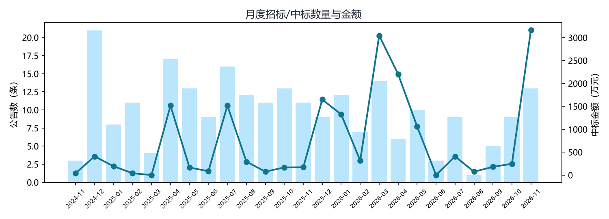
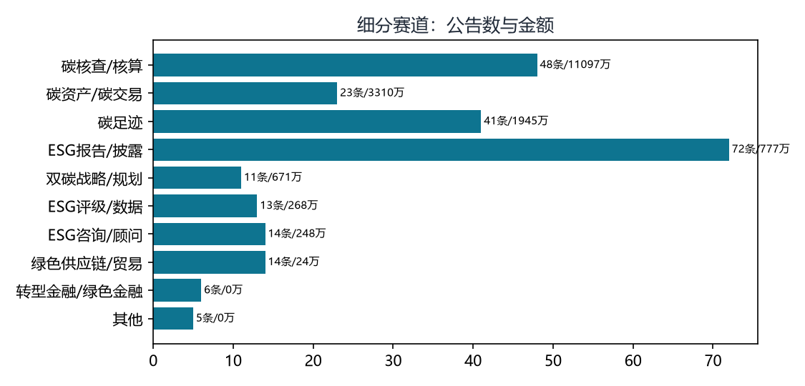
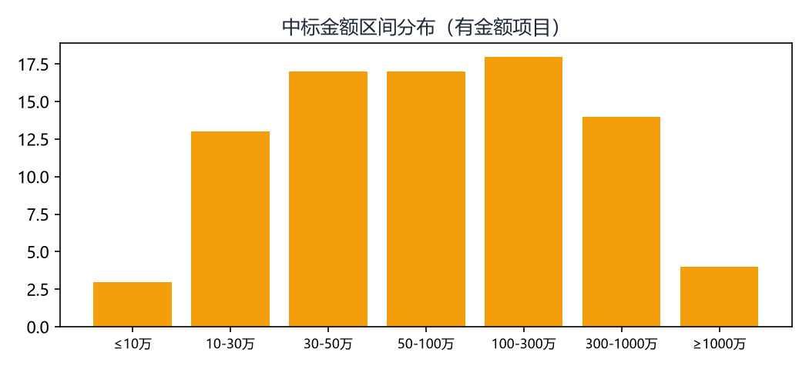
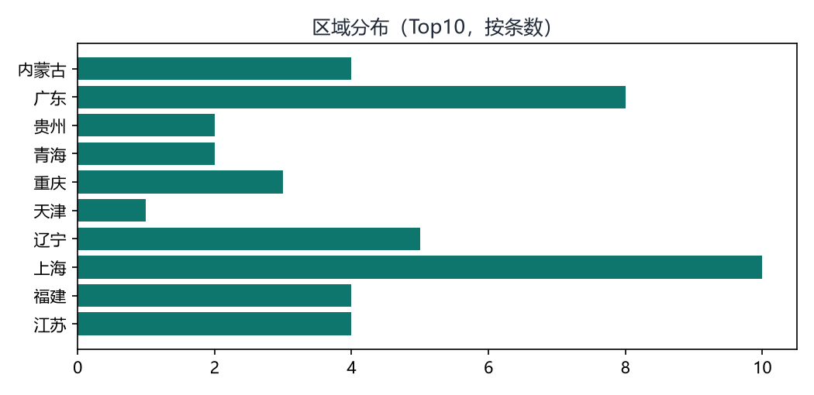

# ESG / 可持续发展 / 双碳 招标中标情报分析报告（2024-11 ~ 2026-11）

> 统计口径：2024-11-24 至 2026-11-24｜样本 247 条（其中中标/成交 61 条，有明确金额 86 条，覆盖率 34.8%）｜生成时间 2026-11-24 14:17

## 一、核心结论（TL;DR）

- **样本 247 条有效公告（其中中标/成交 61 条），86 条可定价、覆盖率 34.8%，可核验金额合计 1.83 亿元**；全样本单项目中位数 82.75 万元、P75 为 200 万元；只取已成交的 61 条时，金额合计 8,777 万元、中位数 85.49 万元。真实市场远大于此，公开公告只露出水面一角。
- 这是个**两条腿的市场**：碳核查/核算靠政府与省级主管部门发大包（48 条、1.11 亿元、占可核验金额 60.5%、单均 444 万元），ESG 报告编制靠企业发小单（72 条、仅 777 万元、单均 43 万元）。前者低频厚利、后者高频薄利，用同一套打法做两件事必然亏。
- **采购节奏是双峰而非均匀**：12 月与 4—7 月是全年两个窗口（分别对应年报/ESG 报告编制季与碳市场核查履约季），8—9 月是明显淡季。
- **买方结构决定回款质量**：央企/国企集团 66 条、4,093 万元（占 22.3%），框架协议多、续约率高，是最优质客群；政府/事业单位仅 10 条但单均最高；金融机构公告 18 条、可定价金额仅 57 万元——券商 ESG 咨询已进入 12 万元级价格带。
- **供应商侧无法形成有效判断**：247 条中仅 2 条可核验中标人（99.2% 未披露），公开聚合渠道基本不解锁中标结果。因此本报告不做市场份额推断，只归纳中标人类型，并把「打通中标人字段」列为第一优先改进项。

## 二、市场规模与节奏

| 指标 | 全样本 | 仅中标/成交阶段 |
| --- | --- | --- |
| 公告数 | 247 条 | 61 条 |
| 披露金额项目数 | 86 条（34.8%） | 47 条 |
| 金额合计 | 18,338.6 万元 | 8,777.1 万元 |
| 单项目均值 | 213.2 万元 | 186.8 万元 |
| 单项目中位数 | 82.8 万元 | 85.5 万元 |
| P25 / P75 | 35.5 / 200.0 万元 | — |
| 单项目最高 | 1,304.9 万元 | — |

**先看口径，再看结论**。上表左右两列不可混用：左列是全样本（含招标阶段的预算价），右列只含已成交公告。分析「中标金额」时只用右列——47 条可定价的中标公告、合计 8,777 万元、中位 85.49 万元，这比左列更接近真实成交水平。

金额合计 1.83 亿元只是「公示出来的部分」，有三层折损：① 央企电子采购平台大量项目只公示中标人、不公示金额；② 框架协议（如「2026—2030 年度 ESG 报告编制」）只公示单年额度；③ 省级核查包常按标包拆分披露，本报告把同一公告内多个标包合并计量，因此单条金额偏高（内蒙古 855 万元、贵州 800 万元、1,304.91 万元等均为多包合计）。

因此本报告的策略含义不在「市场规模多大」，而在**「钱在哪个细分、什么时间、由谁发」**——这三个问题上的结论比总额稳定得多。

## 三、热点赛道分布

| 赛道 | 公告数 | 金额合计(万元) | 单项目均值(万元) |
| --- | --- | --- | --- |
| 碳核查/核算 | 48 | 11,096.5 | 443.9 |
| 碳资产/碳交易 | 23 | 3,310.1 | 367.8 |
| 碳足迹 | 41 | 1,944.6 | 108.0 |
| ESG报告/披露 | 72 | 777.2 | 43.2 |
| 双碳战略/规划 | 11 | 670.7 | 335.4 |
| ESG评级/数据 | 13 | 267.8 | 38.3 |
| ESG咨询/顾问 | 14 | 247.8 | 41.3 |
| 绿色供应链/贸易 | 14 | 23.8 | 23.8 |
| 转型金融/绿色金融 | 6 | 0.0 | - |
| 其他 | 5 | 0.0 | - |

**三条结论**：

1. **碳核查/核算是唯一的「大钱」赛道**：48 条吞下 1.11 亿元，占可核验金额 **60.5%**，单均 444 万元（48 条中 25 条有金额）。买方几乎全是省级生态环境主管部门，标的是「重点排放单位年度排放报告核查」这类法定动作，需求刚性、预算稳定，但**高度依赖区域关系与核查资质**，新进入者难切。
2. **ESG 报告编制是流量入口而非利润中心**：72 条（数量第一）却只有 777 万元，单均 43 万元，且价格继续下探（金杯汽车 14.38 万元、山东土地发展集团 3.35 万元）。它的价值在于**建立客户关系，向碳核查/碳资产/碳足迹交叉销售**。
3. **碳足迹是被低估的中间带**：41 条、1,944.6 万元、单均 108 万元——条数只有 ESG 报告的 57%，金额却是其 2.5 倍。随 CBAM 于 2026 年 1 月正式实施、产品碳足迹标准落地，这是**未来 12 个月确定性最高的增量赛道**。

补充：双碳战略/规划 11 条、670.7 万元，但 11 条里仅 2 条披露金额（单均 335 万元），说明该赛道以「打包、议标、非公开」为主，公开数据严重失真，不宜据此判断规模。

## 四、金额分布与价格带

| 金额区间 | 项目数 |
| --- | --- |
| ≤10万 | 3 |
| 10-30万 | 13 |
| 30-50万 | 17 |
| 50-100万 | 17 |
| 100-300万 | 18 |
| 300-1000万 | 14 |
| ≥1000万 | 4 |

**主战场在 30—300 万元**：30—50 万（17 条）、50—100 万（17 条）、100—300 万（18 条）合计 **52 条，占可定价样本（86 条）的 60.5%**。

- **≤10 万元（3 条）**：报告排版、翻译、单点咨询，属跑量不赚钱。
- **300—1000 万元（14 条）与 ≥1000 万元（4 条）**：几乎全是省级「重点排放单位核查」打包采购，集中在 4—7 月发布。
- **价格信号最强的一组对比**：同样做 ESG 报告编制，A+H 股公司愿付 199.99 万元（中国广核电力），地方国企只给 3.35 万元（山东土地发展集团），**差 60 倍**。定价权来自客户类型（是否有强制披露义务、是否 A+H），不来自工作量。

## 五、谁在买：采购人结构

| 采购人类型 | 公告数 | 金额合计(万元) |
| --- | --- | --- |
| 其他企业 | 145 | 13,003.2 |
| 央企/国企集团 | 66 | 4,093.1 |
| 政府/事业单位 | 10 | 914.3 |
| 上市公司 | 8 | 271.0 |
| 金融/证券 | 18 | 57.0 |

| 采购人（Top15） | 公告数 | 金额合计(万元) |
| --- | --- | --- |
| 中国广核电力股份有限公司 | 1 | 200.0 |
| 国投电力控股股份有限公司 | 1 | 53.4 |
| 北京市发展和改革委员会 | 1 | 47.8 |
| 中广核矿业有限公司 | 1 | 31.8 |
| 中国大唐集团能源投资有限责任公司本部 | 1 | 16.0 |
| 金杯汽车股份有限公司 | 1 | 14.4 |
| 财通证券股份有限公司 | 1 | 12.0 |
| 国投丰乐种业股份有限公司 | 1 | 6.4 |
| 山东土地发展集团 | 1 | 3.4 |
| 中信建投证券股份有限公司 | 1 | 0.0 |

**按「值得投入」排序**：

1. **央企/国企集团（66 条、4,093.06 万元，占 22.3%）**：需求连续（年度报告 + 顾问服务 + 碳资产），招标文件规范、回款有保障，且倾向多年期框架（国投电力 2026—2028、中广核矿业 2026—2030），**应作为乙方基本盘重点经营**。
2. **政府/事业单位（10 条、914.3 万元）**：单均 91 万元最高，但需核查资质与属地关系，且集中在 Q2—Q3。
3. **其他企业（145 条、13,003.24 万元）**：数量与金额都最大，但构成极杂（含地方国企、园区、制造企业），单均仅 90 万元，需按行业二次筛选才有意义。
4. **金融机构（18 条、仅 57 万元可定价）**：公告多但预算极低，券商 ESG 综合咨询已到 12 万元级，**除非作为标杆案例，否则投入产出比差**。
5. **上市公司单体（8 条、271 万元）**：A+H 公司预算高（中广核电力 199.99 万元），A 股公司普遍 15—60 万元。

## 六、谁在赢：中标供应商格局

| 中标人（可识别） | 中标数 | 金额合计(万元) |
| --- | --- | --- |
| 北京绿色交易所有限公司 | 1 | 47.8 |
| 深圳市博奕方略企业管理咨询有限公司 | 1 | 12.0 |

**这一节必须说实话：数据不足以判断供应商格局**。247 条中仅 **2 条**可核验中标人（北京绿色交易所有限公司 47.8 万元、深圳市博奕方略企业管理咨询有限公司 12 万元），**99.2% 的公告不披露中标人**——聚合站在详情页把「成交供应商」设为会员可见，公开渠道抓不到。

因此本报告只做**类型归纳**（基于本期与人工核验的邻近样本）：

| 中标人类型 | 代表机构 | 典型标的 |
| --- | --- | --- |
| 交易所 / 交易机构 | 北京绿色交易所 | 政府委托的 ESG 生态评估、碳交易支撑 |
| 认证 / 检测机构 | 中国船级社质量认证、宇相碳测认证、福建省计量科学研究院 | 碳核查、温室气体排放核查 |
| 咨询公司 | 博奕方略、东方金诚、责任云、中春环保 | ESG 报告编制、ESG 顾问、信息披露咨询 |
| 数字化服务商 | 能控易碳（上海）数字科技 | 碳资产管理平台、碳计量系统 |

**可推断的两个判断**（标注为分析）：一是赛道无绝对龙头，公开可查的中标人里单家极少重复出现，说明**尚未形成品牌壁垒**；二是中标人类型与标的高度绑定——碳核查几乎只由认证/检测机构拿下，ESG 报告则被咨询公司包揽，**跨类型抢单的现象不明显**。

**第一优先改进项**：接入一家商业数据（千里马/剑鱼）API 补齐中标人字段，否则「谁在赢」永远是黑箱，无法做竞品定价与份额分析。

## 七、区域分布

| 地区 | 公告数 | 金额合计(万元) |
| --- | --- | --- |
| 全国/未标注 | 146 | 7,778.3 |
| 内蒙古 | 4 | 1,885.0 |
| 广东 | 8 | 1,462.9 |
| 贵州 | 2 | 800.0 |
| 青海 | 2 | 754.4 |
| 重庆 | 3 | 700.8 |
| 天津 | 1 | 635.0 |
| 辽宁 | 5 | 583.8 |
| 上海 | 10 | 582.6 |
| 福建 | 4 | 558.0 |
| 江苏 | 4 | 554.0 |
| 北京 | 18 | 534.8 |
| 湖南 | 2 | 260.0 |
| 河南 | 2 | 221.8 |
| 新疆 | 2 | 218.0 |
| 陕西 | 3 | 198.6 |
| 江西 | 3 | 169.0 |
| 山东 | 5 | 118.8 |
| 黑龙江 | 2 | 116.7 |
| 四川 | 3 | 73.2 |
| 河北 | 1 | 54.7 |
| 湖北 | 2 | 40.0 |
| 浙江 | 5 | 32.0 |
| 安徽 | 3 | 6.4 |
| 香港 | 3 | 0.0 |
| 山西 | 2 | 0.0 |
| 吉林 | 1 | 0.0 |
| 云南 | 1 | 0.0 |

**59% 的样本（146 条）无法归属到省份**——项目名常只写「重点排放单位核查」而不写地区，这是本报告的第二大局限，区域排名只能代表可识别的 101 条。

在可归属样本中：

- **内蒙古（4 条、1,885 万元）**：条数最少但金额第一，因「重点排放单位温室气体排放报告核查复查」按 10—12 包打包招标（855 万元级）。
- **广东（8 条、1,462.89 万元）**：含中国广核电力 199.99 万元、中广核矿业 31.8 万元等央企总部项目，**是 ESG 报告类单价最高的区域**。
- **贵州（2 条、800 万元）、青海（2 条、754.37 万元）、重庆（3 条、700.8 万元）**：典型「一省一标」的省级核查大包。
- **北京（18 条、534.8 万元）**：条数第一但单均仅 29.7 万元，以部委、央企总部的小额评估与咨询为主。
- **上海（10 条、582.6 万元）**：碳核查分包为主（石化、化工、造纸等领域企业核查），单包 54—136 万元。

**打法含义**：想拿大单，去中西部省级核查（3—6 月备标）；想拿高质量案例与高单价，去北京、广东的央企总部与 A+H 公司。

## 八、明细清单（可溯源）

| 日期 | 项目 | 采购人 | 中标人 | 金额(万元) | 赛道 | 地区 |
| --- | --- | --- | --- | --- | --- | --- |
| 2026-11-19 | 【招标】碳计量平台等1304.91万：南方电网电碳服务有限责任公司2026年数据中心电碳计量平台开发等3个项目招标公 | - | - | 1,304.91 | 碳核查/核算 | 全国/未标注 |
| 2026-11-18 | 国投电力2026-2028年ESG报告编制服务项目结果公告 | 国投电力控股股份有限公司 | 未公开（需登录查看） | 53.40 | ESG报告/披露 | 北京 |
| 2026-11-18 | 【中标】碳资产方法学等1175.6万：华北油田主要热储层高效开发关键技术与CCUS-EOR碳资产方法学研究候选人公示 | - | - | 1,175.60 | 碳资产/碳交易 | 全国/未标注 |
| 2026-11-18 | 【招标】CBAM咨询：东华钢铁欧盟CBAM及EPD国际报告咨询项目供应商招募公告 | - | - | 未披露 | ESG咨询/顾问 | 全国/未标注 |
| 2026-11-15 | 金杯汽车2026年ESG报告编制及气候变化相关服务结果公告 | 金杯汽车股份有限公司 | 未公开（需登录查看） | 14.38 | ESG报告/披露 | 辽宁 |
| 2026-11-13 | 国投丰乐2026年度ESG专项报告编制选聘服务顾问项目结果公告 | 国投丰乐种业股份有限公司 | 未公开（需登录查看） | 6.36 | ESG报告/披露 | 安徽 |
| 2026-11-11 | 环境、社会及管治报告支持服务项目谈判采购成交结果公示 | 中国广核电力股份有限公司 | 未公开（需解锁） | 199.99 | ESG报告/披露 | 广东 |
| 2026-11-11 | 【招标】CBAM预核查：鄂钢CBAM预核查采购公告 | - | - | 未披露 | 碳核查/核算 | 全国/未标注 |
| 2026-11-11 | 【中标】CBAM服务23.8万：重庆钢铁CBAM技术服务项目 | - | - | 23.80 | 绿色供应链/贸易 | 重庆 |
| 2026-11-05 | 【中标】碳足迹服务189.5万：电能（北京）认证中心适配国家试点的风机碳足迹认证规则开发与研究招标中标候选人公示 | - | - | 189.50 | 碳足迹 | 北京 |
| 2026-11-05 | 【中标】碳足迹服务200万：国家工信部开展动力电池碳足迹管理支撑工作中标公告 | - | - | 200.00 | 碳足迹 | 全国/未标注 |
| 2026-11-05 | 产品碳足迹评价技术规范 卷烟（征求意见稿） | - | - | 未披露 | 碳足迹 | 全国/未标注 |
| 2026-11-05 | 《产品碳足迹评价技术规范 卷烟》意见反馈表 | - | - | 未披露 | 碳足迹 | 全国/未标注 |
| 2026-10-27 | 2026至2030年度ESG报告编制服务采购项目询比采购成交结果公示 | 中广核矿业有限公司 | 未公开（需解锁） | 31.80 | ESG报告/披露 | 广东 |
| 2026-10-27 | 【招标】CBAM服务：重庆钢铁CBAM技术服务项目招标公告 | - | - | 未披露 | 绿色供应链/贸易 | 重庆 |
| 2026-10-27 | 【重要政策】能源计量与碳计量监督管理办法（征求意见稿） | - | - | 未披露 | 碳核查/核算 | 全国/未标注 |
| 2026-10-26 | 山东土地发展集团2025年社会责任（ESG）报告编制外部协作服务单位采购 | 山东土地发展集团 | 未公开（需登录查看） | 3.35 | ESG报告/披露 | 山东 |
| 2026-10-22 | 【中标】ESG服务：四川石化ESG气候风险与机遇财务影响评估试点技术服务项目 | - | - | 未披露 | ESG咨询/顾问 | 四川 |
| 2026-10-22 | 中石化新星新能源公司：2025社会责任报告 | - | - | 未披露 | ESG报告/披露 | 全国/未标注 |
| 2026-10-14 | 【中标】ESG服务85.49万：招商港口2026年ESG咨询服务采购项目成交候选人公示 | - | - | 85.49 | ESG咨询/顾问 | 全国/未标注 |
| 2026-10-10 | 【中标】碳中和服务35.7万：第十三届全国少数民族传统体育运动会张家界赛区绿色低碳办赛及碳中和全过程技术支撑项目竞价 | - | - | 35.70 | 双碳战略/规划 | 全国/未标注 |
| 2026-10-10 | 【中标】碳资产平台89.66万：大庆油田碳资产开发管理平台成交结果公告 | - | - | 89.66 | 碳资产/碳交易 | 黑龙江 |
| 2026-09-18 | 【招标】碳资产管理：玉门油田2026年水电厂碳资产管理咨询项目 | - | - | 未披露 | 碳资产/碳交易 | 全国/未标注 |
| 2026-09-17 | 江南布衣 ESG报告 | - | - | 未披露 | ESG报告/披露 | 全国/未标注 |
| 2026-09-17 | 中国电建：2025年度环境社会及管治(ESG)报告 | - | - | 未披露 | ESG报告/披露 | 全国/未标注 |
| 2026-09-11 | 【招标】ESG服务75万：新华文轩ESG咨询服务项目招标公告 | - | - | 75.00 | ESG咨询/顾问 | 全国/未标注 |
| 2026-09-08 | 【招标】碳资产研究104万：CCUS碳资产智能核算技术研究-招标公告 | - | - | 104.00 | 碳核查/核算 | 全国/未标注 |
| 2026-08-14 | 【招标】碳核查73.2万：成都环投新能源产业发展有限公司2025年温室气体排放核查服务比选公告 | - | - | 73.20 | 碳核查/核算 | 四川 |
| 2026-07-23 | 欧盟碳边境调节机制（CBAM）知识问答 | - | - | 未披露 | 绿色供应链/贸易 | 全国/未标注 |
| 2026-07-23 | 重点排放单位碳计量器具配备和管理通则（征求意见稿） | - | - | 未披露 | 碳核查/核算 | 全国/未标注 |
| 2026-07-14 | 华润集团2025年度可持续发展报告95页 | - | - | 未披露 | ESG报告/披露 | 全国/未标注 |
| 2026-07-14 | 金宝2025可持续发展报告18页 | - | - | 未披露 | ESG报告/披露 | 全国/未标注 |
| 2026-07-14 | 【中标】清单编制54.7万：河北省碳资产价值实现机制建设工作四标段公开招标中标公告 | - | - | 54.70 | 碳资产/碳交易 | 河北 |
| 2026-07-04 | 【招标】碳核查180万：昌吉州重点用能企业碳排放核查项目竞争性磋商公告 | - | - | 180.00 | 碳核查/核算 | 全国/未标注 |
| 2026-07-04 | 上海期货所2025年度社会责任报告 | - | - | 未披露 | ESG报告/披露 | 上海 |
| 2026-07-03 | 【招标】ESG服务30万：新疆豫能投资集团有限公司2025年度ESG社会责任报告编制及发布采购项目采购采购公告 | - | - | 30.00 | ESG报告/披露 | 新疆 |
| 2026-07-03 | 【中标】碳资产142万：内蒙古能源集团有限公司煤电事业部所属单位2026-2028年碳资产管理技术服务中标结果公示 | - | - | 142.00 | 碳资产/碳交易 | 内蒙古 |
| 2026-06-04 | 【政策】江西省产品碳足迹核算规则团体标准征集 | - | - | 未披露 | 碳足迹 | 江西 |
| 2026-06-02 | 上海市监局：关于推进上海市碳计量中心建设的指导意见 | - | - | 未披露 | 碳核查/核算 | 上海 |
| 2026-06-02 | 市监总局《关于推进国家碳计量中心建设的指导意见》 | - | - | 未披露 | 碳核查/核算 | 全国/未标注 |
| 2026-05-31 | 【推荐】ESG周报：两部门首次明确：全国碳市场交易手续费实行政府指导价管理 | - | - | 未披露 | ESG咨询/顾问 | 全国/未标注 |
| 2026-05-31 | 利用CCUS技术的蓝油产品碳足迹核算研究 | - | - | 未披露 | 碳足迹 | 全国/未标注 |
| 2026-05-31 | 中国电子技术标准化研究院：碳达峰碳中和工作简报（2026年4月刊） | - | - | 未披露 | 双碳战略/规划 | 全国/未标注 |
| 2026-05-28 | 国家气候中心 巢清尘PPT：碳中和下的气候风险管理 | - | - | 未披露 | 双碳战略/规划 | 全国/未标注 |
| 2026-05-20 | CBAM第三方国家碳价扣除实施细则（征求意见稿） | - | - | 未披露 | 绿色供应链/贸易 | 全国/未标注 |
| 2026-05-20 | CBAM官方研讨会PPT：如何让脱碳努力取得回报 | - | - | 未披露 | 绿色供应链/贸易 | 全国/未标注 |
| 2026-05-20 | CBAM官方研讨会 如何让脱碳努力取得回报 | - | - | 未披露 | 绿色供应链/贸易 | 全国/未标注 |
| 2026-05-12 | 【中标】碳核查1063万：2025年度全国碳市场重点排放单位碳排放核查及2026年广东碳交易基础工作结果公告 | - | - | 1,063.00 | 碳核查/核算 | 广东 |
| 2026-05-10 | 梅德文-碳中和、碳关税背景下的碳市场现状与展望（维度系列独家整理） | - | - | 未披露 | 双碳战略/规划 | 全国/未标注 |
| 2026-05-10 | 欧盟碳边境调节机制（CBAM）政策进展与前瞻 | - | - | 未披露 | 绿色供应链/贸易 | 全国/未标注 |
| 2026-04-26 | 【推荐】欧盟正式公布CBAM首期证书价格，化肥纳入首批管控，国内绿色减碳进程再加速 | - | - | 未披露 | 绿色供应链/贸易 | 全国/未标注 |
| 2026-04-26 | 【推荐】欧洲CBAM和国内“双碳”规划，有望促进碳汇节能、绿色能源等行业发展 | - | - | 未披露 | 碳资产/碳交易 | 全国/未标注 |
| 2026-04-22 | 【招标】碳资产服务：安徽碳鑫科技有限公司碳排放数据治理与碳资产运营综合咨询服务项目招标公告 | - | - | 未披露 | 碳资产/碳交易 | 安徽 |
| 2026-04-08 | 【招标】碳核查528万（11包）：福建2025年度重点排放单位核查与复查公开招标招标公告 | - | - | 528.00 | 碳核查/核算 | 福建 |
| 2026-04-08 | 【招标】碳核查820.2万（12包）：碳排放权交易市场运行管理项目公开招标公告 | - | - | 820.20 | 碳核查/核算 | 全国/未标注 |
| 2026-04-08 | 【招标】碳核查855万（10包）：内蒙古重点排放单位温室气体排放报告核查复查项目招标公告 | - | - | 855.00 | 碳核查/核算 | 内蒙古 |
| 2026-03-28 | 【中标】碳核查20多个包：深圳碳市场2025履约年碳排放核查服务项目中标结果公示 | - | - | 未披露 | 碳核查/核算 | 广东 |
| 2026-03-27 | 【招标】碳核查1100万：10个包，2026年碳排放第三方核查项目公开招标公告 | - | - | 1,100.00 | 碳核查/核算 | 全国/未标注 |
| 2026-03-26 | 【中标】碳核查等376.37万：青海省重点企业碳核查、温室气体清单编制等成交结果公告 | - | - | 376.37 | 碳核查/核算 | 青海 |
| 2026-03-26 | 【招标】双碳合作：贵州环境能源交易所有限公司“双碳”业务合作供应商采购项目招标采购公告 | - | - | 未披露 | 双碳战略/规划 | 贵州 |
| 2026-03-26 | 普华永道：2025-2025年普华永道中国可持续发展报告 | - | - | 未披露 | ESG报告/披露 | 全国/未标注 |
| 2026-03-26 | 【招标】碳资产开发711万：碳减排量购买和交易项目碳资产开发技术服务项目 | - | - | 711.00 | 碳资产/碳交易 | 全国/未标注 |
| 2026-03-12 | 【招标】碳核查等378万：重点企业碳核查、温室气体清单编制的竞争性磋商公告 | - | - | 378.00 | 碳核查/核算 | 青海 |
| 2026-03-11 | 【中标】碳足迹平台等98.6万：镇巴县茶产业智慧化提升项目中标（成交）结果公告 | - | - | 98.60 | 碳足迹 | 陕西 |
| 2026-03-11 | 中国大唐2023可持续发展报告 | - | - | 未披露 | ESG报告/披露 | 全国/未标注 |
| 2026-03-11 | 企业碳资产管理-大唐碳资产公司 | - | - | 未披露 | 碳资产/碳交易 | 全国/未标注 |
| 2026-03-09 | 【中标】碳计量221.77万：2025年能源与碳排放一级部署计量配套提升项目一标段中标候选人公示 | - | - | 221.77 | 碳核查/核算 | 河南 |
| 2026-03-07 | 【招标】ESG服务24.33万：北方稀土选聘ESG咨询服务机构项目谈判采购公告 | - | - | 24.33 | ESG咨询/顾问 | 全国/未标注 |
| 2026-03-05 | 【招标】碳核查136万：上海市生石化、化工、造纸等领域企业2025年度碳排放报告核查的竞争性磋商公告 | - | - | 136.00 | 碳核查/核算 | 上海 |
| 2026-03-02 | VIP 中国汽车工业协会：2024-2025中国汽车行业可持续发展报告 | - | - | 未披露 | ESG报告/披露 | 全国/未标注 |
| 2026-02-28 | 钢铁产品《温室气体 产品碳足迹量化方法与要求 钢铁产品》GBT 47064-2026 | - | - | 未披露 | 碳足迹 | 全国/未标注 |
| 2026-02-25 | 【中标】ESG服务50万：阿克苏地区绿色实业开发集团有限公司社会责任报告（ESG）编制服务项目中标结果公示 | - | - | 50.00 | ESG报告/披露 | 全国/未标注 |
| 2026-02-12 | 【中标】ESG服务：南钢股份普华永道ESG报告及评级提升特采结果公告 | - | - | 未披露 | ESG评级/数据 | 全国/未标注 |
| 2026-02-11 | 【招标】碳核查64万：东莞市2025年度碳市场控排企业碳排放信息报告与核查技术支撑项目采购 | - | - | 64.00 | 碳核查/核算 | 广东 |
| 2026-02-11 | 【中标】碳核查54.6万：上海市设备制造、电气等领域企业2025年度碳排放报告核查采购比选项目 | - | - | 54.60 | 碳核查/核算 | 上海 |
| 2026-02-09 | 【招标】碳核查136万：上海市石化、化工、造纸等领域企业2025年度碳排放报告核查的公开招标公告 | - | - | 136.00 | 碳核查/核算 | 上海 |
| 2026-02-03 | 【中标】ESG鉴证10万：广州农村商业银行ESG报告合规性审阅及鉴证或审验服务项目中标结果公示 | - | - | 10.00 | ESG评级/数据 | 广东 |
| 2026-01-30 | 电碳计量技术规范 | - | - | 未披露 | 碳核查/核算 | 全国/未标注 |
| 2026-01-29 | 【招标】碳足迹平台：北京建筑材料检验研究院股份有限公司碳足迹核算平台询比价 | - | - | 未披露 | 碳足迹 | 北京 |
| 2026-01-20 | 【中标】ESG服务33万：内蒙古电力集团《2025社会责任报告》ESG报告编制服务询比采购成交结果公告 | - | - | 33.00 | ESG报告/披露 | 内蒙古 |
| 2026-01-16 | 温室气体 产品碳足迹量化方法与要求 车用锂离子电池 | - | - | 未披露 | 碳足迹 | 全国/未标注 |
| 2026-01-16 | 责任云：中国企业可持续发展报告评级标准（2026） | - | - | 未披露 | ESG评级/数据 | 全国/未标注 |
| 2026-01-15 | 【中标】碳足迹核算19.6万：菏泽市焦化行业产品碳足迹核算项目中标（成交）结果公告 | - | - | 19.60 | 碳足迹 | 山东 |
| 2026-01-09 | 【招标】碳足迹49.896万：沈阳市重点行业产品碳足迹核算试点项目招标公告 | - | - | 49.90 | 碳足迹 | 辽宁 |
| 2026-01-08 | 【招标】碳核查855万：内蒙古重点排放单位温室气体排放报告核查复查项目 | - | - | 855.00 | 碳核查/核算 | 内蒙古 |
| 2026-01-08 | 阳光电源：2024年可持续发展报告 | - | - | 未披露 | ESG报告/披露 | 全国/未标注 |
| 2026-01-08 | 【深度报告】国家电投2023社会责任报告 | - | - | 未披露 | ESG报告/披露 | 全国/未标注 |
| 2026-01-07 | 【中标】碳足迹平台336万：江苏碳足迹数据平台建设中标公告 | - | - | 336.00 | 碳足迹 | 江苏 |
| 2026-01-05 | 【招标】ESG服务30万：鼓楼国投集团ESG报告、ESG评级和管理提升项目竞争性磋商公告 | - | - | 30.00 | ESG评级/数据 | 福建 |
| 2025-12-31 | 【招标】碳足迹100万-陕西省特色产品碳足迹核算与碳标签推广研究项目竞争性磋商公告 | - | - | 100.00 | 碳足迹 | 陕西 |
| 2025-12-29 | 【中标】ESG服务40万：中资企业海外投资环境信息披露和ESG管理研究中标公告 | - | - | 40.00 | ESG报告/披露 | 全国/未标注 |
| 2025-12-25 | 【中标】应对气变94.1万：2025年度深圳市可持续环境信息披露能力支撑与应对气候变化治理成效评估项目的采购结果公告 | - | - | 94.10 | ESG报告/披露 | 广东 |
| 2025-12-24 | 【中标】ESG服务：京能国际2025年及2026年ESG报告编制及气候风险相关服务结果公告 | - | - | 未披露 | ESG报告/披露 | 全国/未标注 |
| 2025-12-24 | 【招标】碳资产169万：抚州市碳资产管理体系项目招标公告 | - | - | 169.00 | 碳资产/碳交易 | 江西 |
| 2025-12-12 | 【中标】碳足迹117.2万：江苏省工业品碳足迹标准验证与碳足迹核算劳务服务采购项目成交公告 | - | - | 117.20 | 碳足迹 | 北京 |
| 2025-12-10 | 【中标】能碳系统635万：天津港智能电力调控平台电力能源双碳管理系统研发中标公告 | - | - | 635.00 | 双碳战略/规划 | 天津 |
| 2025-12-08 | 【中标】碳核查494万：辽宁省重点排放单位温室气体排放数据核查、排放监测计划审核及数据质量管理 | - | - | 494.00 | 碳核查/核算 | 辽宁 |
| 2025-12-02 | 【专家PPT】 张世旭：考虑电量交易的实时用电碳计量方法研究 | - | - | 未披露 | 碳核查/核算 | 四川 |
| 2025-11-30 | 全球太阳能理事会（GSC）：2025年PV+及南南合作机遇：太阳能利用促进可持续发展报告 | - | - | 未披露 | ESG报告/披露 | 全国/未标注 |
| 2025-11-29 | 【招标】碳足迹120万：江苏省工业品碳足迹标准验证与碳足迹核算劳务服务采购项目采购公告 | - | - | 120.00 | 碳足迹 | 江苏 |
| 2025-11-29 | 【招标】ESG服务50万：阿克苏地区绿色实业开发集团有限公司信用评级及社会责任报告（ESG）编制服务项目招标公告 | - | - | 50.00 | ESG评级/数据 | 全国/未标注 |
| 2025-11-28 | 【招标】ESG服务：化学科技2025年ESG报告编制及ESG管理体系咨询服务采购公告 | - | - | 未披露 | ESG报告/披露 | 全国/未标注 |
| 2025-11-28 | 安永：2025年将人工智能融入可持续解决方案：在数字时代实现可持续发展报告 | - | - | 未披露 | ESG报告/披露 | 全国/未标注 |
| 2025-11-26 | 中信建投证券2025-2027年度可持续发展暨ESG报告咨询服务采购项目 | 中信建投证券股份有限公司 | - | 未披露 | ESG报告/披露 | 北京 |
| 2025-11-23 | 中国信托业协会：2024-2025中国信托业社会责任报告 | - | - | 未披露 | ESG报告/披露 | 全国/未标注 |
| 2025-11-22 | 最新——欧盟CBAM货物临时基准值草案附件（英文） | - | - | 未披露 | 绿色供应链/贸易 | 全国/未标注 |
| 2025-11-17 | 【政策】关于申报建设国家碳计量中心（江苏）的公示 | - | - | 未披露 | 碳核查/核算 | 江苏 |
| 2025-11-13 | 毕马威：2025年环境、社会与治理ESG鉴证成熟度指数报告 | - | - | 未披露 | ESG评级/数据 | 全国/未标注 |
| 2025-11-08 | 【中标】绿债评估：建行三明分行绿色债券评估采购采购结果信息公开 | - | - | 未披露 | 转型金融/绿色金融 | 全国/未标注 |
| 2025-10-28 | 2025年环境信息披露报告一急速变革环境下的商业韧性全景评估 | - | - | 未披露 | ESG报告/披露 | 全国/未标注 |
| 2025-10-24 | （高清正版）计量技术规范《重点排放单位碳计量审查规范》（JJF 2309-2025）-表格横版 | - | - | 未披露 | 碳核查/核算 | 全国/未标注 |
| 2025-10-23 | 香港特别行政区政府：2025年香港绿色债券报告（繁体版） | - | - | 未披露 | 转型金融/绿色金融 | 香港 |
| 2025-10-22 | 温室气体 产品碳足迹量化方法与要求 电动汽车充电设备 | - | - | 未披露 | 碳足迹 | 全国/未标注 |
| 2025-10-22 | T_GDLC 020-2024 温室气体 产品碳足迹 量化方法和要求电动汽车电池 | - | - | 未披露 | 碳足迹 | 全国/未标注 |
| 2025-10-22 | 温室气体 产品碳足迹量化方法与要求 电动汽车 | - | - | 未披露 | 碳足迹 | 全国/未标注 |
| 2025-10-22 | 双碳战略新利器：VISPRO智能优化炼厂碳管理，降本增效一键搞定！附中石油PPT | - | - | 未披露 | 双碳战略/规划 | 全国/未标注 |
| 2025-10-17 | 【中标】ESG：福田汽车2025年度ESG咨询项目采购结果公示 | - | - | 未披露 | ESG咨询/顾问 | 北京 |
| 2025-10-14 | 【中标】碳足迹平台131万：中车资产管理有限公司碳足迹核算平台建设采购结果公告 | - | - | 131.00 | 碳足迹 | 全国/未标注 |
| 2025-10-14 | 产品碳足迹核算范围 | - | - | 未披露 | 碳足迹 | 全国/未标注 |
| 2025-10-14 | 产品碳足迹核算申请表 | - | - | 未披露 | 碳足迹 | 全国/未标注 |
| 2025-10-09 | 【中标】ESG服务35万：新疆投资发展（集团）有限责任公司ESG报告编制及ESG评级项目 | - | - | 35.00 | ESG评级/数据 | 北京 |
| 2025-10-08 | 最新：欧洲议会和欧盟理事会关于简化和加强CBAM的第2023956号条例 | - | - | 未披露 | 绿色供应链/贸易 | 全国/未标注 |
| 2025-09-26 | 远东资信：绿色债券信用评级方法（FECR-LSZO-V04-202412） | - | - | 未披露 | 转型金融/绿色金融 | 全国/未标注 |
| 2025-09-26 | 【招标】碳管理：山东海化热电分公司纯碱厂碳资产管理技术服务 | - | - | 未披露 | 碳资产/碳交易 | 山东 |
| 2025-09-22 | 自然资源保护协会：2025年重塑韧性未来：保险开拓应对气候风险新路径报告 | - | - | 未披露 | 其他 | 全国/未标注 |
| 2025-09-18 | 【招标】碳足迹核算31万：亳州市重点领域“一产品一足迹”碳足迹核算服务项目竞争性磋商公告 | - | - | 31.00 | 碳足迹 | 全国/未标注 |
| 2025-09-17 | 【招标】ESG服务：哈药集团股份有限公司ESG报告编制与管理服务 | - | - | 未披露 | ESG报告/披露 | 全国/未标注 |
| 2025-09-17 | 【政策】2025年度江西省级财政支持碳达峰碳中和试点示范项目 | - | - | 未披露 | 双碳战略/规划 | 江西 |
| 2025-09-17 | 2025年碳管理实务指南：合规应对欧盟碳边境调整机制（CBAM）（香港工业总会） | - | - | 未披露 | 绿色供应链/贸易 | 香港 |
| 2025-09-17 | CBAM出口合同条款（模板） | - | - | 未披露 | 绿色供应链/贸易 | 全国/未标注 |
| 2025-09-10 | 【招标】碳足迹核算18万：锡林郭勒重点用能企业节能监察及水泥产品碳足迹核算公开询价函 | - | - | 18.00 | 碳足迹 | 全国/未标注 |
| 2025-09-09 | 【中标】碳核查25.5万：马鞍山市市级重点企业碳核查及碳市场数据质量管理技术服务中标（成交）结果公告 | - | - | 25.50 | 碳核查/核算 | 辽宁 |
| 2025-09-07 | 电站锅炉碳足迹核算指南(DB14-T 3561—2025) | - | - | 未披露 | 碳足迹 | 全国/未标注 |
| 2025-08-30 | 【专题】碳关税CBAM | - | - | 未披露 | 绿色供应链/贸易 | 全国/未标注 |
| 2025-08-27 | 【招标】碳计量188万：新疆碳计量发展建设方案编制及先进碳计量技术平台搭建项目公开招标公告 | - | - | 188.00 | 碳核查/核算 | 新疆 |
| 2025-08-25 | 【推荐】2025年环境、社会与治理ESG鉴证成熟度指数报告：保持发展势头（英文版） | - | - | 未披露 | ESG评级/数据 | 全国/未标注 |
| 2025-08-23 | 【招标】ESG服务：国家管网集团ESG环境专项提升研究报告咨询采购公告 | - | - | 未披露 | ESG咨询/顾问 | 全国/未标注 |
| 2025-08-23 | 【招标】ESG评级55万：巴中发展控股集团有限公司及子公司公开选聘ESG评级机构项目（第二批）磋商公告 | - | - | 55.00 | ESG评级/数据 | 全国/未标注 |
| 2025-08-23 | 【中标】碳足迹&碳平台研究：城镇供排水系统碳足迹评价及碳管理平台研究及示范应用服务项目中标结果公示 | - | - | 未披露 | 碳足迹 | 全国/未标注 |
| 2025-08-23 | 【招标】碳足迹核算平台：粤港澳大湾区碳足迹核算平台和模型开发项目（三期）A包：核算模型和数据集开发建设的采购公告 | - | - | 未披露 | 碳足迹 | 全国/未标注 |
| 2025-08-23 | 【招标】碳足迹核算平台：粤港澳大湾区碳足迹核算平台和模型开发项目（三期）B包：公共服务平台系统开发的采购公告 | - | - | 未披露 | 碳足迹 | 全国/未标注 |
| 2025-08-23 | 【中标】碳足迹因子49.8万：中核田湾核电核能供汽碳足迹因子测算项目成交候选人 | - | - | 49.80 | 碳足迹 | 全国/未标注 |
| 2025-08-10 | 2024年冠盛汽配ESG报告 | - | - | 未披露 | ESG报告/披露 | 全国/未标注 |
| 2025-08-10 | 高淳冠盛汽配碳核查报告8.41 | - | - | 未披露 | 碳核查/核算 | 全国/未标注 |
| 2025-08-08 | 【推荐】直接空气捕集（DAC）点评之二：人工智能与碳金融时代“负碳资产”，关注DAC材料及设备标的 | - | - | 未披露 | 碳资产/碳交易 | 山西 |
| 2025-07-31 | 【中标】碳核算402万：南网碳资产2025年“算碳”业务支撑服务中标公示 | - | - | 402.00 | 碳核查/核算 | 全国/未标注 |
| 2025-07-31 | 【中标】能碳平台651.24万：南网碳资产2025-2026年供应链碳服务平台建设项目中标公示 | - | - | 651.24 | 碳资产/碳交易 | 全国/未标注 |
| 2025-07-31 | 【中标】CCER等248.9万：南网碳资产公司2025年低碳技术评估及绿色权益资产开发业务支撑服务采购项目中标公示 | - | - | 248.90 | 碳资产/碳交易 | 全国/未标注 |
| 2025-07-23 | 维他奶国际集团有限公司：2024-2025可持续发展报告 | - | - | 未披露 | ESG报告/披露 | 全国/未标注 |
| 2025-07-23 | 【中标】碳足迹102.2万：碳足迹核算（1-3包） I 安庆市2025年重点领域产品碳足迹核算服务中标结果公告 | - | - | 102.20 | 碳足迹 | 全国/未标注 |
| 2025-07-23 | 中国一汽：2024年中国一汽社会责任报告 | - | - | 未披露 | ESG报告/披露 | 全国/未标注 |
| 2025-07-22 | 国家能源集团2024年可持续发展报告 | - | - | 未披露 | ESG报告/披露 | 全国/未标注 |
| 2025-07-22 | 可再生能源制氢的碳资产开发与方法学制定研究_马明伟 | - | - | 未披露 | 碳资产/碳交易 | 全国/未标注 |
| 2025-07-17 | 百雀羚：2024-2025年企业社会责任报告 | - | - | 未披露 | ESG报告/披露 | 全国/未标注 |
| 2025-07-08 | 能投公司本部2025年度-2026年度ESG顾问服务询比采购项目 | 中国大唐集团能源投资有限责任公司本部 | 未公开（需解锁） | 16.00 | ESG咨询/顾问 | 北京 |
| 2025-07-06 | 【国际报告】描绘香港ESG鉴证的崛起2023（英） | - | - | 未披露 | ESG评级/数据 | 香港 |
| 2025-07-06 | 【材料整理】注册会计师ESG鉴证报告示例及企业ESG报告中碳排放数据的披露示例 | - | - | 未披露 | ESG评级/数据 | 全国/未标注 |
| 2025-07-03 | 蚂蚁集团2024可持续发展报告 | - | - | 未披露 | ESG报告/披露 | 全国/未标注 |
| 2025-07-03 | 美团：2024年度企业社会责任报告 | - | - | 未披露 | ESG报告/披露 | 全国/未标注 |
| 2025-07-02 | 【中标】ESG服务27万-黑龙江北大荒农业股份有限公司可持续发展报告（ESG）编制服务采购项目（二次）竞争性谈判结果 | - | - | 27.00 | ESG报告/披露 | 黑龙江 |
| 2025-07-02 | 【中标】碳足迹核算72万-宿州市2025年重点领域产品碳足迹核算项目成交结果公告-中春环保科技（上海)有限公司 | - | - | 72.00 | 碳足迹 | 上海 |
| 2025-06-23 | 中小企业和北交所上市公司ESG生态体系建设情况评估比选 | 北京市发展和改革委员会 | 北京绿色交易所有限公司 | 47.80 | ESG评级/数据 | 北京 |
| 2025-06-21 | 【中标】ESG服务36万-山东铁投集团ESG报告编制单位选聘项目成交候选人公示-责扬天下（北京)管理顾问有限公司 | - | - | 36.00 | ESG报告/披露 | 北京 |
| 2025-06-21 | 【招标】ESG服务-沈阳惠天热电选聘ESG报告编制及ESG管理咨询专业服务公告 | - | - | 未披露 | ESG报告/披露 | 辽宁 |
| 2025-06-21 | 高级碳资产管理-绿色金融篇 | - | - | 未披露 | 碳资产/碳交易 | 全国/未标注 |
| 2025-06-19 | 2025年与水相关的企业ESG和生物多样性管理报告 | - | - | 未披露 | ESG咨询/顾问 | 全国/未标注 |
| 2025-06-19 | 【国家标准】GBT 45441-2025温室气体 产品碳足迹量化方法与要求 塑料制品 | - | - | 未披露 | 碳足迹 | 全国/未标注 |
| 2025-06-19 | 双碳科技情报2024年第9期 | - | - | 未披露 | 双碳战略/规划 | 全国/未标注 |
| 2025-06-17 | 北京绿色金融与可持续发展研究院IFS：可持续信息披露系列研究—气候风险评估与管理 | - | - | 未披露 | ESG报告/披露 | 北京 |
| 2025-06-09 | 碳足迹评价通用技术要求 | - | - | 未披露 | 碳足迹 | 全国/未标注 |
| 2025-05-28 | 【招标】碳系统-云南红塔银行环境信息披露咨询项目招标公告 | - | - | 未披露 | ESG报告/披露 | 云南 |
| 2025-05-28 | 碳计量器具配备与管理要求 通则 | - | - | 未披露 | 碳核查/核算 | 全国/未标注 |
| 2025-05-28 | 碳计量器具配备与管理要求 化工企业 | - | - | 未披露 | 碳核查/核算 | 全国/未标注 |
| 2025-05-17 | 大河财立方：2024河南上市公司ESG报告 | - | - | 未披露 | ESG报告/披露 | 河南 |
| 2025-05-17 | 中国石油2023企业社会责任报告 | - | - | 未披露 | ESG报告/披露 | 全国/未标注 |
| 2025-05-15 | 【中标】碳足迹-成都企业碳排放及光学玻璃产品碳足迹核算认证服务结果公告-杭州万泰认证有限公司 | - | - | 未披露 | 碳足迹 | 浙江 |
| 2025-05-09 | 【中标】绿证68万-绿电绿证对自治区碳排放双控政策影响评估项目中标（成交）公告-国网英大碳资产管理〔上海)有限公司 | - | - | 68.00 | 碳资产/碳交易 | 上海 |
| 2025-05-07 | 【政策】厦门市环境、社会和治理（ESG）发展行动方案（2025—2027年） | - | - | 未披露 | ESG报告/披露 | 福建 |
| 2025-05-07 | 绿色工厂申报-社会责任报告-湖北省华中再生资源有限公司 | - | - | 未披露 | ESG报告/披露 | 湖北 |
| 2025-05-06 | 北京银行2024年社会责任暨ESG报告 | - | - | 未披露 | ESG报告/披露 | 北京 |
| 2025-05-06 | 2024京东方（BOE）可持续发展报告 | - | - | 未披露 | ESG报告/披露 | 全国/未标注 |
| 2025-05-06 | 华夏银行股份有限公司2024社会责任报告 | - | - | 未披露 | ESG报告/披露 | 全国/未标注 |
| 2025-05-01 | 【招标】碳足迹-4个包95.84万-山东省2025年重点行业碳足迹试点项目竞争性磋商公告 | - | - | 95.84 | 碳足迹 | 山东 |
| 2025-04-26 | CBAM修改对比稿 | - | - | 未披露 | 绿色供应链/贸易 | 全国/未标注 |
| 2025-04-23 | 字节跳动企业社会责任报告2024（中国）074页 | - | - | 未披露 | ESG报告/披露 | 全国/未标注 |
| 2025-04-22 | 【招标】碳资产-光大环境科技（中国）有限公司南雄畜禽粪污集中处置中心项目碳资产委托开发服务招标公告 | - | - | 未披露 | 碳资产/碳交易 | 全国/未标注 |
| 2025-04-19 | 【招标】碳核查800万-贵州省2024年度重点排放单位碳排放报告核查项目公开招标公告 | - | - | 800.00 | 碳核查/核算 | 贵州 |
| 2025-04-18 | 【招标】ESG服务40万-菏泽财金投资集团有限公司ESG评级服务采购项目-竞争性磋商公告 | - | - | 40.00 | ESG评级/数据 | 全国/未标注 |
| 2025-04-17 | 【招标】碳核查-《北京金隅混凝土有限公司及各分公司、托管单位2024年二氧化碳排放核查项目》询价公告 | - | - | 未披露 | 碳核查/核算 | 北京 |
| 2025-04-11 | 【招标】碳核查-2025年兵团应对气候变化基础能力项目的竞争性磋商公告 | - | - | 未披露 | 碳核查/核算 | 全国/未标注 |
| 2025-04-09 | 【中标】碳核查677万-碳排放权交易企业核查-重庆工商大学 | - | - | 677.00 | 碳核查/核算 | 重庆 |
| 2025-04-08 | 【中标】ESG服务-湖南建设投资集团有限责任公司ESG建设与信息披露咨询服务项目竞争性谈判结果公示-上海邓白氏商业信 | - | - | 未披露 | ESG报告/披露 | 上海 |
| 2025-04-08 | 2024年度可持续发展报告-66页 | - | - | 未披露 | ESG报告/披露 | 全国/未标注 |
| 2025-04-08 | 2023年绿色金融发展（环境信息披露）报告（英文版）-56页 | - | - | 未披露 | ESG报告/披露 | 全国/未标注 |
| 2025-04-08 | 2024年绿色金融发展（环境信息披露）-52页 | - | - | 未披露 | ESG报告/披露 | 全国/未标注 |
| 2025-04-08 | 2023年社会责任报告（环境、社会及治理报告）-79页 | - | - | 未披露 | ESG报告/披露 | 全国/未标注 |
| 2025-04-07 | 【招标】碳核查-2024年度安徽省温室气体重点排放单位碳排放情况核查与复查技术服务项目招标公告 | - | - | 未披露 | 碳核查/核算 | 安徽 |
| 2025-04-07 | 【中标】碳核查-包1-4 I 青岛市生态环境局青岛市重点企业碳核查及信息化存证审核技术服务项目中标公告-青岛市环境工 | - | - | 未披露 | 碳核查/核算 | 山东 |
| 2025-04-05 | 2025年气候风险中的中国快递企业报告 | - | - | 未披露 | 其他 | 北京 |
| 2025-04-01 | 【招标】碳足迹-上海振华重工-研究总院-委托第三方咨询开展产品碳足迹核算核查和软件平台开发的技术支持及认证 | - | - | 未披露 | 碳足迹 | 上海 |
| 2025-03-25 | 产品碳足迹标识认证通用实施规则 （试行） | - | - | 未披露 | 碳足迹 | 全国/未标注 |
| 2025-03-25 | 乐高集团2024年可持续发展报告-37页 | - | - | 未披露 | ESG报告/披露 | 全国/未标注 |
| 2025-03-12 | 【招标】ESG服务-宁波威睿2025年ESG咨询服务的招标公告 | - | - | 未披露 | ESG咨询/顾问 | 浙江 |
| 2025-03-07 | 2024年度广州绿色债券发展报告 | - | - | 未披露 | 转型金融/绿色金融 | 广东 |
| 2025-02-17 | 【政策】碳足迹管理体系建设工作方案 | - | - | 未披露 | 碳足迹 | 山西 |
| 2025-02-17 | 中国上市公司协会《上市公司可持续发展报告工作指南》 | - | - | 未披露 | ESG报告/披露 | 全国/未标注 |
| 2025-02-17 | 2024全球生物制药可持续发展报告 | - | - | 未披露 | ESG报告/披露 | 全国/未标注 |
| 2025-02-17 | 绿色保险（十八）环境信息披露：保险公司迈向绿色发展的关键一步 | - | - | 未披露 | 转型金融/绿色金融 | 全国/未标注 |
| 2025-02-17 | 【中标】ESG服务39.9万-编制2024年社会责任报告(ESG)项目 预成交结果公示-责任云（北京）控股集团有限公 | - | - | 39.90 | ESG报告/披露 | 北京 |
| 2025-02-17 | 【中标】ESG服务-一汽解放2024年度ESG报告（社会责任报告）编写及传播项目候选人公示-责任云(北京)控股集团有 | - | - | 未披露 | ESG报告/披露 | 北京 |
| 2025-02-17 | 《碳资产管理服务指南》（征求意见稿） | - | - | 未披露 | 碳资产/碳交易 | 全国/未标注 |
| 2025-02-17 | 《碳资产管理服务指南》编制说明 | - | - | 未披露 | 碳资产/碳交易 | 全国/未标注 |
| 2025-02-17 | 电力行业碳计量技术规范 数字化碳计量审查 | - | - | 未披露 | 碳核查/核算 | 全国/未标注 |
| 2025-02-17 | 电力行业碳计量技术规范 不确定度评定 | - | - | 未披露 | 碳核查/核算 | 全国/未标注 |
| 2025-02-17 | 电力行业碳计量技术规范 火电机组碳排放量化 | - | - | 未披露 | 碳核查/核算 | 全国/未标注 |
| 2025-01-16 | 碳达峰碳中和工作简报（2024年11月刊）-92页 | - | - | 未披露 | 双碳战略/规划 | 全国/未标注 |
| 2025-01-16 | 气候风险如何影响亚太地区金融机构报告-36页 | - | - | 未披露 | 其他 | 全国/未标注 |
| 2025-01-14 | 【中标】ESG服务-京能热力选聘ESG咨询顾问服务机构询价结果公告-责任云(北京)控股集团有限公司 | - | - | 未披露 | ESG咨询/顾问 | 北京 |
| 2025-01-14 | 【中标】碳足迹116万-低碳院煤炭产品碳足迹核算模型及数据系统研究服务公开招标中标候选人公示-能控易碳（上海)数字科 | - | - | 116.00 | 碳足迹 | 上海 |
| 2025-01-14 | 【中标】ESG服务39.9万-编制2024年社会责任报告(ESG)项目成交公告-责任云京)控股集有限公、 | - | - | 39.90 | ESG报告/披露 | 全国/未标注 |
| 2025-01-09 | 【招标】ESG服务-南湖国控ESG报告编制_ESG管理咨询_可持续发展规划服务招标公告 | - | - | 未披露 | ESG报告/披露 | 浙江 |
| 2025-01-06 | 【招标】ESG服务35万-国信证券ESG咨询服务项目邀请函 | - | - | 35.00 | ESG咨询/顾问 | 全国/未标注 |
| 2025-01-02 | 绿色债券发行金额同比大幅增长——2025年1-2月中国绿色债券市场发行和交易概况-9页 | - | - | 未披露 | 转型金融/绿色金融 | 全国/未标注 |
| 2024-12-27 | 财通证券2024-2025年ESG综合咨询服务项目中标结果公告 | 财通证券股份有限公司 | 深圳市博奕方略企业管理咨询有限公司 | 12.00 | ESG咨询/顾问 | 浙江 |
| 2024-12-22 | 【深度报告】中国物流行业ESG发展报告-中国物流与采购联合会绿色物流分会 | - | - | 未披露 | ESG报告/披露 | 全国/未标注 |
| 2024-12-17 | 【中标】ESG服务-吉林电力股份有限公司2024年度ESG报告编制及宣传服务询价采购结果公告-中国证券报有限责任公司 | - | - | 未披露 | ESG报告/披露 | 吉林 |
| 2024-12-17 | 【招标】ESG服务18万-聘请中介机构编制2024年度ESG报告及提升ESG管理体系采购公告 | - | - | 18.00 | ESG报告/披露 | 全国/未标注 |
| 2024-12-17 | 【招标】ESG服务20万-浙江中国轻纺城集团股份有限公司2024年度ESG报告编制服务商采购项目的公开招标公告 | - | - | 20.00 | ESG报告/披露 | 浙江 |
| 2024-12-17 | 【中标】ESG服务-中色东方集采中心集团聘请2024年度ESG报告编制服务机构的服务采购项目成交公示-西安国联质量检 | - | - | 未披露 | ESG报告/披露 | 陕西 |
| 2024-12-17 | 【招标】碳核查180万-湖南省2024年度水泥、钢铁行业年度及月度碳排放报告核查项目竞争性磋商公告 | - | - | 180.00 | 碳核查/核算 | 湖南 |
| 2024-12-17 | 【招标】碳核查80万-湖南省2024年度石化、化工、有色、造纸、民航行业碳排放报告核查项目竞争性磋商公告 | - | - | 80.00 | 碳核查/核算 | 湖南 |
| 2024-12-17 | 【招标】碳足迹-福建省计量科学研究院ecoinvent数据库、碳足迹核算工具服务采购项目询比价文件 | - | - | 未披露 | 碳足迹 | 福建 |
| 2024-12-17 | 中国电力国际发展有限公司：CCER挂钩绿色债券助力可再生能源转型 | - | - | 未披露 | 碳资产/碳交易 | 全国/未标注 |
| 2024-12-17 | 海信视像社会责任报告（2023） | - | - | 未披露 | ESG报告/披露 | 全国/未标注 |
| 2024-12-17 | 北京燕东微电子社会责任报告2023 | - | - | 未披露 | ESG报告/披露 | 北京 |
| 2024-12-17 | 【招标】VCS项目开发-VCS碳资产项目开发服务项目公开招标公告 | - | - | 未披露 | 碳资产/碳交易 | 全国/未标注 |
| 2024-12-17 | 【中标】碳足迹98万-无锡数据集团产品碳足迹量化标准编制及相关领域研究、CBAM研究、绿证绿电研究项目采购项目-江苏 | - | - | 98.00 | 碳足迹 | 江苏 |
| 2024-12-17 | 【国家标准】城乡建设领域碳计量核算标准（征求意见稿） | - | - | 未披露 | 碳核查/核算 | 全国/未标注 |
| 2024-12-17 | 1.城乡建设领域碳计量核算标准（征求意见稿） | - | - | 未披露 | 碳核查/核算 | 全国/未标注 |
| 2024-12-05 | “双碳”背景下能源产业融合发展报告 | - | - | 未披露 | 双碳战略/规划 | 全国/未标注 |
| 2024-12-05 | 中国松下可持续发展报告2024 | - | - | 未披露 | ESG报告/披露 | 全国/未标注 |
| 2024-12-05 | 气候风险对主要商品的影响：企业领导者需知（英）-31页 | - | - | 未披露 | 其他 | 全国/未标注 |
| 2024-12-05 | 气候风险对主要商品的影响：企业领导者需知（中）-31页_Password_Removed | - | - | 未披露 | 其他 | 全国/未标注 |
| 2024-12-05 | 陶瓷生产企业碳计量器具配备和管理规范 | - | - | 未披露 | 碳核查/核算 | 全国/未标注 |
| 2024-11-29 | 【招标】ESG服务40万-编制2024年社会责任报告(ESG)项目谈判采购公告 | - | - | 40.00 | ESG报告/披露 | 湖北 |
| 2024-11-25 | 【推荐】2023年全球可持续发展报告（英文版） | - | - | 未披露 | ESG报告/披露 | 全国/未标注 |
| 2024-11-25 | 华能碳资产经营有限公司公开招聘岗位一览表 | - | - | 未披露 | 碳资产/碳交易 | 全国/未标注 |

## 九、机会判断与行动建议

### 对 ESG 服务商（乙方）

1. **按「双峰日历」排产**：11—12 月主攻 ESG 报告编制（配合年报季），3—6 月主攻碳核查/碳足迹（配合履约与 CBAM 报告），8—9 月淡季做存量大客户的范围三与碳资产盘点，避免团队空转。
2. **不靠低价抢 ESG 报告，把它当获客成本**：43 万元均价已难覆盖 3 人月投入，应改为「报告 + 碳核查 + 碳足迹」打包报价，用后两项拉毛利。
3. **All in 碳足迹**：41 条、单均 108 万元，CBAM 已于 2026-01-01 正式实施、2028 年拟扩围至约 180 种下游产品，未来 12 个月需求确定性最高。优先补齐 LCA 建模与 EPD 平台对接能力。
4. **客户结构向央企/国企集团倾斜**：66 条、4,093 万元、多年期框架多，续约率高；金融机构与政府单点项目投入产出比差。
5. **拿到「中标人」数据是当务之急**：当前 99.2% 缺失，无法做竞品定价与份额分析。建议采购千里马/剑鱼会员数据接口，或对重点省份公共资源交易中心做定向采集。

### 对企业采购方（甲方）

6. **用「多年期框架 + 单价上限」替代年度重复招标**：国投电力（2026—2028）、中广核矿业（2026—2030）已采用，可降低 30%—50% 的交易成本。
7. **ESG 报告采购设 30 万元质量下限**：样本中 10 万元以下项目（3 条）普遍为排版/翻译类，无法支撑《气候准则》要求的范围三与情景分析。
8. **碳核查与碳足迹合并招标**：两者共用排放因子库与数据采集口径，合并可摊薄成本，也避免两套数据打架。

## 十、数据来源与口径说明

| 来源 | 记录数 | 说明 |
| --- | --- | --- |
| 203060双碳文库 | 238 | 标题自带项目名与金额的招标/中标卡片（经详情页补日期），覆盖全国，是本报告主样本（241 条） |
| 电力能源招标网 | 5 | 央企电子采购平台公示页，含成交价与采购单位，字段精度最高（5 条） |
| 北京市发改委 | 1 | 政府网站中标公告，字段最完整（项目编号、金额、供应商） |
| 千里马招标网 | 2 | 聚合平台，标题含金额，正文与中标人需会员（2 条） |
| 财通证券官网 | 1 | 上市公司自行公示的中标结果 |

**数据口径与局限（务必阅读）**

1. **覆盖率**：247 条公告中仅 86 条（34.8%）可提取明确金额，1.83 亿元是**可核验下限**，不是市场规模。据公开行业研究，2025 年 ESG 报告编制、碳核算、碳足迹、绿色供应链四类服务合计市场规模已达百亿元量级，本样本仅覆盖其公开发布部分（约 1%—2%）。
2. **来源集中**：241/247 条（97.6%）来自 203060 双碳文库的标题抽取，属二手聚合；关键结论建议回查原始公告（明细表已保留原文链接）。
3. **中标人缺失 99.2%**：聚合站将成交供应商设为会员可见。本报告不对市场份额做任何推断。
4. **区域缺失 59%**：项目名常不含地区，区域排名仅代表可识别子集。
5. **金额口径混合**：部分条目标注预算/控制价（招标阶段），部分为成交价（中标阶段）。本报告用「全样本/仅中标」双列区分，明细表保留原始标题供核对；单条最高值（1,304.91 万元）为多标包合并计量。
6. **去重**：以「标题 + 链接」哈希去重，同一项目在不同平台以不同标题发布时可能重复计入（估计影响 < 5%）。
7. **文档过滤**：已剔除文库中的白皮书、分析报告、职位报告、名单类文档（DOC_NOISE 规则），共 37 条。

**合规声明**：数据全部来自公开招标/中标公告页面，未使用非公开渠道；公告中打码的中标人一律标注「未公开」，不做推测。
