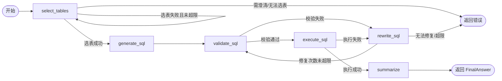

# Chinook SQL Agent — LangGraph 版本

本项目是 `week12/task2`（LangChain 手写编排版本）的 **LangGraph 迁移版**。
业务逻辑、数据契约、提示词、确定性组件（Schema 解析、SQL 校验、SQL 执行）与原项目保持一致，
仅将工作流编排从手写的 `while` 循环改为 `langgraph.graph.StateGraph` 的节点 + 条件边实现。

> 原项目目录 `week12/task2` 全程未被修改，本项目是独立的新目录，二者保持同级关系。

## 与原项目的关系

| 项 | 原项目（`task2`） | 本项目（`task2-langgraph`） |
| --- | --- | --- |
| 编排方式 | `SQLAgentWorkflow.run()` 内手写 `while` 循环 | `StateGraph` 节点 + 条件边，`GraphState`（`TypedDict`）承载状态 |
| Agent 定义（`llm.py`） | `StructuredAgent` + `prompt \| model.bind_tools(...)` | 不变，逐字迁移 |
| 四个业务 Agent | `table_selector` / `sql_generator` / `sql_rewriter` / `result_summarizer` | 不变，逐字迁移 |
| 确定性组件 | `SchemaCatalog` / `SQLValidator` / `SQLExecutor` | 不变，逐字迁移 |
| 数据模型（`models.py`） | Pydantic 模型：`TableSelection` / `SQLDraft` / `ValidationResult` / `ExecutionResult` / `FinalAnswer` 等 | 不变 |
| 数据库 | `task2/ref/chinook.db` | 复用同一个库文件（`config.py` 默认指向 `../task2/ref/chinook.db`，不复制），可用 `SQL_AGENT_DB` 覆盖 |
| CLI | `python -m sql_agent "问题"` | 相同入口，相同参数 |
| 设计原则 | 六条原则（见下） | 不变 |

### 保留的六条设计原则

1. LLM 只做语义判断（选表、生成/改写 SQL、结果汇总），校验与执行必须是确定性代码。
2. 一个 Agent 只做一个决策，不把选表、生成、纠错、总结塞进同一个 prompt。
3. 上下文最小化：选表阶段只看目录摘要，生成/改写阶段只看已选表的详细 schema。
4. 编排用代码控制，不使用 Agent 自主 handoff。
5. 失败重试次数有上限（选表最多 2 次，SQL 校验/执行修复共享 `max_repair_attempts`，默认 3 次），超限后返回明确错误。
6. 结果为空时不重试，直接返回"未查询到符合条件的数据"。

## 架构差异：LangChain 手写编排 → LangGraph StateGraph

原版本 `workflow.py` 中 `SQLAgentWorkflow.run()` 用显式的 `while True` 循环驱动"校验 → 执行/改写"的重试逻辑，状态保存在一个局部对象里，由方法调用顺序隐式表达控制流。

本版本把同一套状态机显式搭建成图：



- **状态**：`GraphState`（`TypedDict`），字段与原 `QueryState` 含义一一对应；`attempts` 字段用 `Annotated[list[SQLAttempt], _append]` 声明为追加型 reducer，替代原来对列表的 `.append()` 调用。
- **节点**：`_select_tables_node` / `_generate_sql_node` / `_validate_sql_node` / `_execute_sql_node` / `_rewrite_sql_node` / `_summarize_node`，每个节点对应原流程里的一个步骤，内部逻辑（prompt 拼接、日志、调用哪个 Agent）逐字保留。
- **条件边**：替代原来的 `if/while` 判断，根据 `select_attempts`、`validation.ok`、`repair_attempts` 等状态字段决定下一个节点或终止。
- **对外接口不变**：`SQLAgentWorkflow(catalog=..., validator=..., executor=...)` 构造参数、`await workflow.run(question)` 调用方式与返回的 `WorkflowOutput` 结构都和原项目一致，方便对照测试。

## 项目结构

```
src/sql_agent/
  __init__.py / __main__.py
  cli.py              # 命令行入口，与原项目相同参数
  config.py           # 环境变量配置，默认复用 task2/ref/chinook.db
  logging_config.py   # 日志配置（输出到 stderr）
  llm.py              # StructuredAgent 装配层（prompt | bind_tools 链）
  models.py           # Pydantic 数据契约
  workflow.py         # LangGraph StateGraph 编排（本项目的核心改动）
  api.py              # FastAPI 应用：/api/query、/healthz、静态页面挂载
  webserver.py        # uvicorn 启动入口（sql-agent-web / python -m sql_agent.webserver）
  agents/
    table_selector.py     # 选表 Agent
    sql_generator.py      # SQL 生成 Agent
    sql_rewriter.py        # SQL 改写 Agent
    result_summarizer.py   # 结果汇总 Agent
  db/
    catalog.py          # Schema/外键/样例解析与缓存
    validator.py        # 安全校验 + EXPLAIN 编译校验（只读）
    executor.py          # 只读执行，限制超时/行数/截断
static/
  index.html          # 对话式前端页面（原生 HTML/CSS/JS，无构建工具链）
tests/
  test_llm.py       # StructuredAgent 装配层测试（10 项）
  test_db_tools.py  # Schema/校验/执行测试（14 项）
  test_workflow.py  # StateGraph 端到端测试（6 项）
  test_logging.py   # 日志配置测试（1 项）
  test_api.py       # FastAPI 路由测试（5 项）
```

## 运行

```powershell
# 安装依赖（建议使用独立虚拟环境）
pip install -e .[dev]

# 设置 API Key（必需）
$env:OPENAI_API_KEY = "sk-..."
# OPENAI_BASE_URL 默认是 DeepSeek 端点，DashScope 兼容模式需覆盖
# $env:OPENAI_BASE_URL = "https://dashscope.aliyuncs.com/compatible-mode/v1"

# 运行 CLI
$env:PYTHONPATH = "src"
python -m sql_agent "总共有多少张专辑？"
```

常用环境变量（与原项目一致）：

- `SQL_AGENT_DB`：覆盖默认数据库路径（默认 `../task2/ref/chinook.db`）。
- `SQL_AGENT_MODEL` / `SQL_AGENT_SUMMARY_MODEL`：覆盖主模型/汇总模型，默认 `deepseek-flash`。
- `SQL_AGENT_TOOL_CHOICE`：结构化输出的 `tool_choice`，默认 `auto`（思考模式模型必须保持 `auto`）。
- `SQL_AGENT_LOG_LEVEL`：日志级别，默认 `INFO`。

## Web 前端（FastAPI）

新增了一个最小化的对话式网页，用户在浏览器里输入自然语言问题，后端调用同一套
`SQLAgentWorkflow` 并把 `WorkflowOutput` 结果渲染成对话气泡。前端是单个静态
HTML 文件（`static/index.html`，原生 JS + `fetch`，无构建工具链），由 FastAPI
（`src/sql_agent/api.py`）托管。

```powershell
# 安装依赖（已包含 fastapi / uvicorn）
pip install -e .[dev]

$env:OPENAI_API_KEY = "sk-..."
$env:PYTHONPATH = "src"

# 启动服务，默认监听 127.0.0.1:8000（仅本机）
python -m sql_agent.webserver
# 或：uvicorn sql_agent.api:app --reload
# 或（安装后）：sql-agent-web --port 8000
```

浏览器打开 `http://127.0.0.1:8000/` 即可对话。

接口说明：

- `POST /api/query`：请求体 `{"question": "..."}`，返回与 CLI 相同结构的 `WorkflowOutput` JSON（`answer`/`sql`/`tables`/`row_count`/`evidence`/`caveats`/`error` 等）。
- `GET /healthz`：健康检查，返回 `{"status": "ok"}`。
- `GET /`：对话页面；`GET /static/*`：静态资源。

实现要点：

- **启动时构建一次 workflow**：`api.py` 用 FastAPI 的 `lifespan` 在应用启动阶段调用一次 `build_workflow()`，所有请求复用同一个 `SQLAgentWorkflow` 实例，避免每次请求都重新解析 `SchemaCatalog`（schema 解析是只读操作，`SQLValidator`/`SQLExecutor` 每次调用也都是无状态只读执行，复用是安全的）。
- **对话模式**：当前是单轮问答——每次请求独立调用 `workflow.run(question)`，不维护跨请求的会话上下文（与原设计"不支持多轮追问"的范围保持一致）；前端只是把历史问答展示成聊天气泡，不会把历史消息传给后端。
- **错误处理**：请求体校验失败返回 422（FastAPI/Pydantic 默认行为），问题为空字符串返回 400，workflow 执行抛未预期异常时记录日志并返回 500，正常的业务级错误（比如选表失败超限）仍然通过 `WorkflowOutput.error` 字段返回 200。
- **安全提示**：当前没有加任何身份验证或速率限制，`webserver.py` 默认绑定 `127.0.0.1`（仅本机可访问）。如果要在内网或公网暴露，需要自行加鉴权（比如反向代理 + Basic Auth/OAuth）、速率限制，并评估 CORS 策略（当前为了本地调试放开了 `allow_origins=["*"]`）。

## 测试

测试不依赖 `OPENAI_API_KEY`，LLM 调用均已 mock：

```powershell
$env:PYTHONPATH = "src"
python -m pytest -v
```

当前 36 项测试全部通过（`test_db_tools.py` 14 项 + `test_llm.py` 10 项 + `test_logging.py` 1 项 + `test_workflow.py` 6 项 + `test_api.py` 5 项）。

## 未变更的约束

- 所有数据库访问只读：SQLAlchemy 连接串带 `mode=ro&uri=true`，`SQLValidator` 只用 `EXPLAIN` 编译，从不真正执行。
- 结构化输出通过「工具定义 + `tool_choice=auto` + Pydantic 校验」实现，兼容 DeepSeek/DashScope 的思考模式模型（它们拒绝被强制指定 `tool_choice`，也不支持 `json_schema` response format）。
- 注释、文档字符串、提示词、用户可见回答保持中文。
