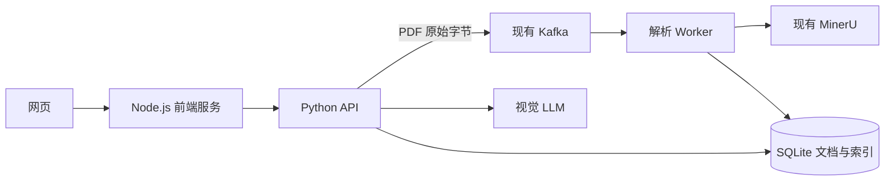

# Kafka 多模态 PDF 问答

在 Linux 云服务器上复用已有 Kafka、MinerU 和 Node.js。Node.js 提供网页和同源 API 转发。Python API 写入 Kafka，独立的 Python Worker 消费 PDF 后调用 MinerU，保存文本、原图、页码和检索索引。



## 在云服务器启动

需要 Node.js 18+，以及 Docker Compose 或 Python 3.10+。将部署包解压到服务器，进入包含 `compose.yaml` 的目录。

```bash
cp .env.example .env
```

编辑 `.env`，填好以下字段。

| 配置 | 填写方式 |
| --- | --- |
| `KAFKA_BOOTSTRAP_SERVERS` | Kafka 客户端地址。同机、可通过回环访问时填 `127.0.0.1:9092`。 |
| `KAFKA_TOPIC` | 本项目专用 Topic，默认 `rag.pdf.v1`。 |
| `MINERU_URL` | 自托管 MinerU 的完整 `/file_parse` 地址。默认 `http://127.0.0.1:8000/file_parse`。 |
| `MINERU_BACKEND` | 与已有 MinerU 服务一致，默认 `pipeline`。 |
| `LLM_BASE_URL` | 支持视觉输入、兼容 Chat Completions 的服务地址，按供应商要求包含 `/v1`。 |
| `LLM_MODEL`、`LLM_API_KEY` | 视觉模型名称和密钥。无需认证的模型服务可将密钥留空。 |

MinerU 接口采用 `mineru-api` 2.6.8 的 JSON 契约。可以在现有服务的 `/docs` 中确认 `POST /file_parse` 接收 `files`、`return_content_list` 和 `return_images`。只有 `/v1/tasks` 或 `/v1/file_parse` 的服务使用另一套协议，需要更换适配器。 [MinerU 2.6.8 API 实现](https://github.com/opendatalab/MinerU/blob/mineru-2.6.8-released/mineru/cli/fast_api.py) · [MinerU Tasks API](https://github.com/opendatalab/MinerU/blob/master/docs/en/usage/tasks.md)

每份 PDF 作为一条 Kafka 消息，默认文件上限为 10 MiB。首次使用时在现有 Kafka 上创建专用 Topic。下面假设是单节点 Kafka，且当前目录是 Kafka 安装目录。按实际环境替换地址和副本数。若 Topic 已存在，检查 `max.message.bytes` 足以容纳文件和消息头，默认建议至少 11 MiB。 [Kafka Topic 配置](https://kafka.apache.org/41/configuration/topic-configs/)

```bash
bin/kafka-topics.sh --bootstrap-server 127.0.0.1:9092 \
  --create --if-not-exists --topic rag.pdf.v1 --partitions 1 --replication-factor 1 \
  --config max.message.bytes=11534336
```

回到项目目录，启动后端，再用已有的 Node.js 启动网页。

```bash
docker compose up -d --build
node frontend/server.mjs
```

API 和 Worker 使用 Linux 主机网络，可访问宿主机的 Kafka 和 MinerU 回环端口。Python API 默认监听 `127.0.0.1:8081`，Node.js 监听 `127.0.0.1:3000`。从自己的电脑访问时，可以用 SSH 端口转发，然后打开浏览器的 `http://127.0.0.1:3000`。

```bash
ssh -N -L 3000:127.0.0.1:3000 your-user@your-server
```

已有网站入口时，可将该入口的反向代理指向 Node.js 的 `127.0.0.1:3000`。Node.js 支持通过 `WEB_HOST`、`WEB_PORT` 和 `API_BASE_URL` 环境变量修改监听地址和后端地址。本应用使用共享文档库，访问控制由入口代理提供。

如果云服务器没有 Docker，可以在 Python 虚拟环境安装 `requirements.txt`，把 `.env` 中的配置注入两个进程，再分别运行以下命令。两个进程共用工作目录下的 `data/rag.sqlite3`，也可用 `RAG_DATABASE` 指定共同路径。

```bash
python3 -m venv .venv
.venv/bin/pip install -r requirements.txt
.venv/bin/gunicorn --bind 127.0.0.1:8081 --workers 1 --threads 4 --timeout 190 'backend.service:make_app()'
# 另一个终端，注入相同环境变量后启动 Worker。
.venv/bin/python -m backend.service worker
```

## 验收

1. 上传两份带图 PDF。每份独立显示「待解析」「解析中」「解析完成」。页面通过轮询更新，较快的中间状态可能在两次轮询之间结束。解析失败会单独显示原因。
2. 问「文档中的光谱实验说明了什么？请附原图」。命中相关图注或正文时，可在回答段落之间看到 PDF 原图，以及来源文件和页码。
3. 上传一张图并问「图里的峰值是多少？对应哪份文档？」模型先生成检索词，再收到用户原图、原问题与检索证据。每次提问独立处理。

也可以用命令检查网页代理和入队状态。

```bash
curl --fail-with-body http://127.0.0.1:3000/api/health
curl --fail-with-body -F 'files=@first.pdf' -F 'files=@second.pdf' http://127.0.0.1:3000/api/documents
curl --fail-with-body http://127.0.0.1:3000/api/documents
docker compose logs --tail=80 api worker
```

文档只有在 Kafka 确认接收后才进入待解析。Worker 将文本、原图、索引和完成状态放在同一个 SQLite 事务中，提交后再提交 Kafka 消费位点。首版用 SQLite FTS5 检索正文、图注和相邻段落，支持中文双字分词。解析产物存放在 `rag-data` 卷。原始 PDF 按 Kafka Topic 的保留策略保存。

运行代码测试时，先在虚拟环境安装 `requirements.txt`，然后运行 `python -m unittest discover -s tests -v` 与 `node --test frontend/server.test.mjs`。Python 测试用固定的 MinerU 和模型 HTTP 响应验证应用行为，云服务器的真实联调以上述验收步骤为准。
