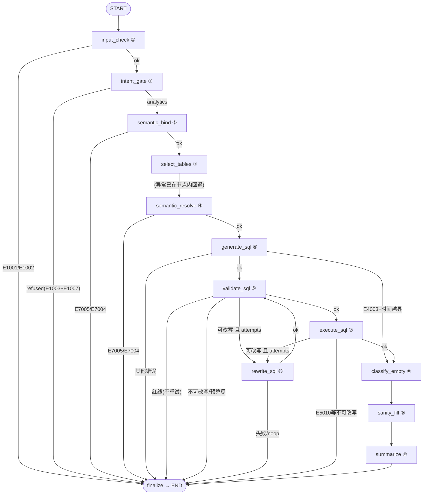

# 00 · LangChain/LangGraph 改造方案

> 源项目：`第11周/Week12/06_SQL-Agent-Project`（Chinook ChatBI SQL Agent，纯 Python + OpenAI SDK 手写编排）
> 目标项目：`Week12_2026Q2/sql-agent-langchain`
> 方案日期：2026-10-29

---

## 1. 改造目标与原则

**目标**：用 LangChain（组件层）+ LangGraph（编排层）重建 SQL Agent，业务能力 1:1 完整平移，UI/CLI/测试/评测集全量移植。

**三条改造原则**：

1. **只换两层**：LLM 调用层（手写 OpenAI 封装 → LangChain Chat Model）、编排层（`SQLAgent.run()` 手写 if/for → LangGraph StateGraph）。其余业务模块原样平移。
2. **对外契约不变**：`AgentResult` 字段、错误码体系（E1001–E8009）、TraceStep 结构、`SQLAgent.run(question, user_code)` 签名全部保留——这是 UI / CLI / 评测集能近乎零改动平移的前提。
3. **安全语义不变**：只读执行、sqlglot 校验、PII 脱敏、预算控制、审计 trace 的行为与源项目一致。

## 2. 源项目架构摘要（改造基线）

```text
run(question)
 ├─ ① 输入检查（空/超长 → E1001/E1002）
 ├─ ① 意图门禁（规则正则 + 可选 LLM 兜底；拒答 5 类 → E1003~E1007）
 ├─ ② 语义预检（未定义指标 → E7005 拒答，不浪费 LLM 调用）
 ├─ ③ 选表（中文关键词提示 + LLM JSON 输出 + 外键补桥接 + 失败回退全表）
 ├─ ④ 语义解析（metrics.yaml 指标口径/时间范围/实体别名，结合选中表定变体）
 ├─ ⑤ SQL 生成（DDL+样例行+值域+few-shot+语义约束；时间越界时 E4003 短路为空结果）
 ├─ ⑥⑦ 校验/改写/执行循环（sqlglot 静态校验+EXPLAIN 动态校验；
 │        失败→LLM 反思改写，≤3 次；安全红线直接终止；只读执行+脱敏+截断）
 ├─ ⑧ 空结果归因（out_of_range / conditions_too_strict / true_zero / unknown）
 ├─ ⑨ sanity 检查 + 月度序列补零
 ├─ ⑩ 受约束汇总（LLM claims + 程序化 grounding，失败回退模板答案）
 └─ finalize（错误码补全 + ResultContract + JSONL 审计写入）
```

- LLM 层：`LLM.chat/chat_json/chat_result`，每次调用前后扣减 `Budget`（20s 截止 / 8 次调用 / 6 万 tokens / ¥0.10 成本），429 限流重试 1 次，错误码稳定映射。
- 提示词：`prompts.py` 用 `string.Template`（`$var`），5 个模板（SELECTOR/GENERATOR/REWRITE/SUMMARY/INTENT）。
- 配套：Streamlit UI（app.py）、CLI（main.py）、130 题 6 分片评测集（eval/）、115 项离线测试（tests/）。

## 3. 已确认的决策

| 决策点 | 结论 |
|---|---|
| 编排方式 | **LangChain 组件 + LangGraph StateGraph**（循环重试、条件分支、意图短路都是图的一等公民） |
| 能力保留 | **完整平移**：意图门禁、语义层、校验、改写、只读执行、脱敏、预算、归因、grounding、审计全保留 |
| 配套设施 | **全量移植**：UI + CLI + 离线测试 + 130 题评测集 |
| 项目名 | `sql-agent-langchain` |
| 模型 | DeepSeek（经 LangChain OpenAI 兼容层接入，配置与源项目一致） |

## 4. 技术选型

| 组件 | 选型 | 说明 |
|---|---|---|
| Chat Model | `langchain-openai.ChatOpenAI`（base_url=api.deepseek.com） | DeepSeek 官方 OpenAI 兼容；教程生态最通用。备选 `langchain-deepseek.ChatDeepSeek` |
| 编排 | `langgraph.StateGraph` | 条件边实现意图短路/红线终止；环实现改写循环；`recursion_limit` 兜底 |
| 提示词 | `ChatPromptTemplate` | `$var` → `{var}`，模板文本语义不变 |
| 结构化输出 | `with_structured_output()`（Pydantic schema）+ 保留 `extract_json` 兜底 | 选表/汇总用结构化输出，体现 LangChain 能力；JSON 容错解析保留 |
| 预算注入 | LangGraph `context` 依赖注入（`graph.invoke(state, config={"context": {...}})`） | Budget/trace_id 按请求创建，不进 state，保持 state 可序列化 |
| 校验/执行 | sqlglot + sqlite3 原样平移 | 不用 LangChain SQLDatabase（会丢失表白名单/函数白名单/PII 管控） |
| 依赖 | `langchain>=1.0, langchain-openai>=1.0, langgraph>=1.0` + 原有依赖（pandas/sqlglot/PyYAML/streamlit/pytest/python-dotenv） | Python ≥3.10 |

**刻意不用**的东西：LangChain 内置 `SQLDatabaseToolkit`/`create_sql_agent`（丢失全部安全设计）、LangChain SQL Database chain（无法挂语义层与预算）。

## 5. 总体架构

### 5.1 分层

```text
┌────────────────────────────────────────────────────┐
│ 入口层：app.py(Streamlit) / main.py(CLI) / eval/    │  ← 契约不变，近乎原样平移
├────────────────────────────────────────────────────┤
│ 门面层：agent.SQLAgent.run() → 组装 AgentResult     │  ← 签名不变，内部改调 graph
├────────────────────────────────────────────────────┤
│ 编排层：graph.build_graph()（LangGraph StateGraph） │  ← 新增，替代 run() 手写流程
│   12 节点 + 9 组条件边 + 1 个改写环                  │
├────────────────────────────────────────────────────┤
│ 组件层：intent/selector/generator/rewriter/         │  ← 业务逻辑原样平移
│   validator/executor/summarizer/semantic/...        │    LLM 调用改走 LangChain
├────────────────────────────────────────────────────┤
│ LLM 层：llm.py = ChatOpenAI 封装 + Budget 记账      │  ← 重写（接口不变）
│   chat()/chat_json()/chat_result() 三方法保留       │
└────────────────────────────────────────────────────┘
```

### 5.2 LangGraph 状态机

**状态定义（`state.py`，TypedDict）**：

```python
class AgentState(TypedDict, total=False):
    # 会话标识（只读）
    question: str; user_code: str; trace_id: str; started_at: str
    # append-only 追踪（reducer: operator.add）
    steps: Annotated[list[dict], operator.add]
    warnings: Annotated[list[dict], operator.add]
    assumptions: Annotated[list[str], operator.add]
    history: Annotated[list[dict], operator.add]      # 改写尝试历史
    # 各节点产物
    intent: dict | None            # 意图分类结果
    selection: dict | None          # 选表结果
    resolution: dict | None        # 语义解析（指标+时间+别名）
    schema_text: str
    sql: str
    attempts: int
    validation: dict | None        # sqlglot 校验结果
    execution: dict | None         # 执行结果（列/行/截断/脱敏）
    empty: dict | None             # 空结果归因
    summary: dict | None           # 汇总（answer/claims/grounding）
    # 路由与终止（节点写入，条件边消费）
    route: str                     # ok / refused / redline / rewrite / finalize / empty_shortcut ...
    error_code: str; error: str; user_message: str
    answer: str; suggestions: list[str]
```

**节点与条件边（`graph.py`）**：



**关键路由逻辑**（与源项目 `run()` 逐条对应）：

| 条件边 | 判定 | 去向 |
|---|---|---|
| after `validate_sql` | 校验通过 | `execute_sql` |
| | 红线码（REDLINE_CODES） | `finalize`（不重试） |
| | `attempts > max_rewrites` 或 `budget.can_call()==False` | `finalize` |
| | 其他 | `rewrite_sql`（history 追加本次 SQL+错误） |
| after `execute_sql` | 执行成功 | `classify_empty` |
| | `E5010`（noop）/ 超改写上限 / 预算尽 | `finalize` |
| | 其他执行错误 | `rewrite_sql` |
| after `generate_sql` | `E4003` 且 `time_range.out_of_range` | `classify_empty`（短路为空结果，源项目 ⑤ 分支） |
| 改写环 | `recursion_limit = 2*max_rewrites + 12` 兜底防死循环 | — |

**运行时依赖注入**：`Budget`、`trace_id`、`LLM 实例`在 `SQLAgent.run()` 创建，经 `config={"context": {...}}` 注入，节点内 `get_context()` 读取。state 保持纯数据可序列化（为未来接 checkpointer 留路）。

### 5.3 LLM 层重写（`llm.py`）

门面三方法 `chat() / chat_json() / chat_result()` 签名不变（selector/generator/rewriter/summarizer 的调用代码近乎零改动），内部实现替换：

```python
class LLM:
    def __init__(...):
        self.model = ChatOpenAI(
            model=settings.model, api_key=..., base_url=...,
            timeout=settings.llm_timeout_cap_s, max_retries=0,  # 重试自己控制
        )

    def chat_result(self, messages, temperature, max_tokens, budget, step):
        budget.before_call(step)                     # 保留原语义
        timeout = budget.call_timeout(self.default_timeout)
        resp = self.model.bind(timeout=timeout, max_tokens=max_tokens,
                               temperature=temperature).invoke(msgs)
        usage = LLMUsage.from_response(resp.usage_metadata, ...)  # 从 AIMessage.usage_metadata 记账
        budget.record_usage(usage)
        ...  # 429/401/超时 → LLMError(E8002/E8001/E4004/E4001) 映射保留，429 sleep 1s 重试 1 次

    def chat_json(self, messages, schema=None, ...):
        if schema:  # LangChain 结构化输出
            structured = self.model.with_structured_output(schema)
            return structured.invoke(...)
        return extract_json(self.chat(...))          # 兜底解析保留
```

**提示词平移**：`prompts.py` 中 `string.Template($var)` → `ChatPromptTemplate({var})`，5 个模板文本逐字保留（`prompt_version` 不变），模板变量名不变。

### 5.4 各 LLM 调用模块的改造方式

| 模块 | 改造 |
|---|---|
| `intent.py` | 规则正则不变；LLM 兜底分支改走门面 `chat_json`（结构化输出 Pydantic `IntentOut`） |
| `selector.py` | `chat_json` → `with_structured_output(SelectionOut{tables,reason,confidence})`；关键词提示/外键补桥/回退逻辑不变 |
| `generator.py` / `rewriter.py` | 文本输出，`extract_sql` 保留；温度/max_tokens/错误包装不变 |
| `summarizer.py` | `chat` + `extract_json` 保留；claims/grounding/模板回退逻辑不变 |
| `validator.py` / `executor.py` / `semantic.py` / `contracts.py` / `privacy.py` / `catalog.py` / `budget.py` / `trace_store.py` / `errors.py` / `config.py` | **原样平移**（不依赖 LLM） |

## 6. 目录结构

```text
sql-agent-langchain/
├── sql_agent/
│   ├── __init__.py
│   ├── config.py          # 平移（.env 读取，CHINOOK_DB 默认指向 data/chinook.db）
│   ├── errors.py          # 原样平移
│   ├── budget.py          # 原样平移
│   ├── catalog.py          # 原样平移
│   ├── semantic.py         # 原样平移
│   ├── privacy.py          # 原样平移
│   ├── contracts.py        # 原样平移
│   ├── trace_store.py      # 原样平移
│   ├── validator.py        # 原样平移
│   ├── executor.py         # 原样平移
│   ├── prompts.py          # 平移 + 改 ChatPromptTemplate（$var→{var}）
│   ├── intent.py           # 规则不变；LLM 兜底换 LangChain
│   ├── selector.py         # 结构化输出换 LangChain，逻辑不变
│   ├── generator.py        # LLM 调用换 LangChain，逻辑不变
│   ├── rewriter.py         # 同上
│   ├── summarizer.py       # 同上
│   ├── llm.py              # 重写：ChatOpenAI 封装 + Budget 记账 + 结构化输出（接口不变）
│   ├── state.py            # 新增：AgentState TypedDict
│   ├── graph.py            # 新增：build_graph() 12 节点 + 条件边 + 改写环
│   └── agent.py            # 重写：SQLAgent 门面（run 签名不变，内部 graph.invoke + finalize）
├── data/chinook.db         # 复制自源项目（自包含）
├── semantic/               # metrics.yaml + entity_aliases.yaml 原样复制
├── eval/                   # evaluate.py + gold.jsonl(130题) + baseline.json + _gold_build.py 平移
├── tests/                  # 115 项平移 + 新增 graph 路由测试（FakeChatModel）
├── docs/                   # 本方案 + 后续设计文档
├── app.py                  # Streamlit UI 平移（仅 import 路径不变）
├── main.py                 # CLI 平移
├── sql_agent_langgraph_demo.ipynb  # 新增：分步演示 + graph 可视化（mermaid）
├── .env.example / .gitignore / requirements.txt / README.md
```

## 7. 实施计划

| 里程碑 | 内容 | 验证 |
|---|---|---|
| **M1 基础设施** | 目录骨架；复制 chinook.db / semantic/*.yaml；平移 config/errors/budget/catalog/semantic/privacy/contracts/trace_store/validator/executor/prompts + 对应测试 | 平移的离线测试全绿 |
| **M2 LLM 层** | 重写 `llm.py`（ChatOpenAI + Budget 记账 + 错误码映射 + 结构化输出）；改造 intent/selector/generator/rewriter/summarizer 的 LLM 调用 | 模块单测绿；有 key 时手动冒烟一次 |
| **M3 编排层** | `state.py` + `graph.py`（12 节点/条件边/改写环/context 注入）+ `agent.py` 门面 + `main.py` CLI | graph 路由离线测试绿；CLI 全链路冒烟 |
| **M4 配套** | Streamlit `app.py`；评测集 eval/ 平移；demo notebook（含 `graph.get_graph().draw_mermaid()`） | `streamlit run app.py` 冒烟；`eval --verify-gold` 通过 |
| **M5 验收** | 全量 pytest；README；CLI/UI/eval 三入口冒烟；（可选，需 key）评测跑分与源项目基线对比 | 交付清单逐项勾选 |

## 8. 测试与验收

- **平移测试**：115 项离线测试中依赖 `LLM` 接口的 fake 实现保持同接口即可平移；纯业务测试（validator/executor/semantic/budget/contracts/privacy/trace_store）原样复制。
- **新增测试**（LangGraph 特有）：
  - 意图拒答 → 3 节点内短路到 finalize，不触发生成/执行
  - 校验失败 → 改写环循环，`attempts` 达 `max_rewrites` 后终止
  - 红线 SQL → 不进改写，直接 finalize
  - `generate_sql` 时间越界短路 → 空结果归因路径
  - Budget 耗尽 → 后续节点走 fallback/终止，错误码 E8004
  - fake LLM 用 `langchain_core.language_models.fake_chat_models`（`GenericFakeChatModel`/`FakeListChatModel`）
- **验收门槛**：pytest 全绿；三入口冒烟通过；UI 展示 trace/steps 与源项目一致；`AgentResult.to_dict()` 字段与源项目兼容（eval 无需改动即可跑）。

## 9. 风险与对策

| 风险 | 对策 |
|---|---|
| `AIMessage.usage_metadata` 取不到 token 用量 | 门面从 `response_metadata`/`usage_metadata` 双路径取；仍失败则按 0 计并打警告（不阻断） |
| `with_structured_output` 在 DeepSeek 上不稳 | 保留 `extract_json` 兜底；结构化输出仅用于 selector，失败自动降级 |
| LangGraph 改写环死循环 | 条件边显式判 `attempts` 与预算；`recursion_limit=2*max_rewrites+12` 双保险 |
| 429 重试语义漂移（原逻辑：sleep 1s 重试 1 次） | ChatOpenAI 设 `max_retries=0`，门面内保留原重试代码 |
| 动态 per-call 超时（原 `min(budget.remaining(), 15s)`） | `model.bind(timeout=...)` per-request 覆盖；bind 不支持则每次请求新建轻量 model 实例 |
| 评测结果与源项目有偏差 | evaluate.py 平移后先 `--verify-gold`，再小样本 `--limit 10` 对比，不追平不收尾 |

## 10. 待确认事项

无——四项关键决策（编排方式/保留范围/配套设施/项目名）已确认。实施中如遇 LangChain 版本 API 细节与方案不符（如 context 注入方式），按"最接近原语义"原则现场决策并记录到本文档附录。
